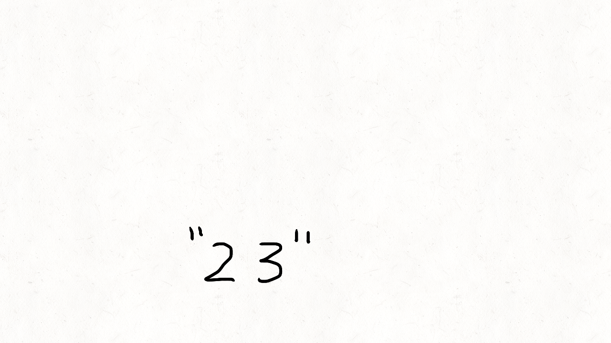
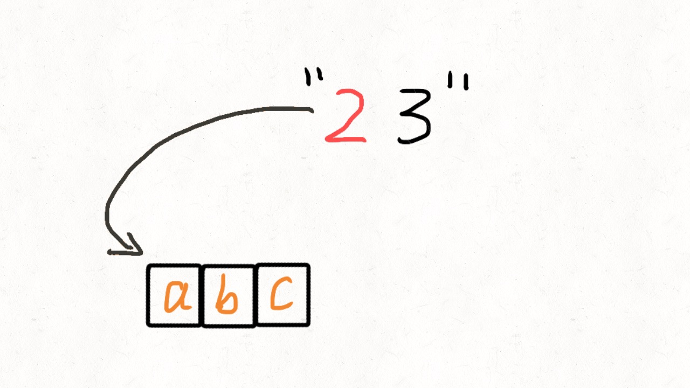
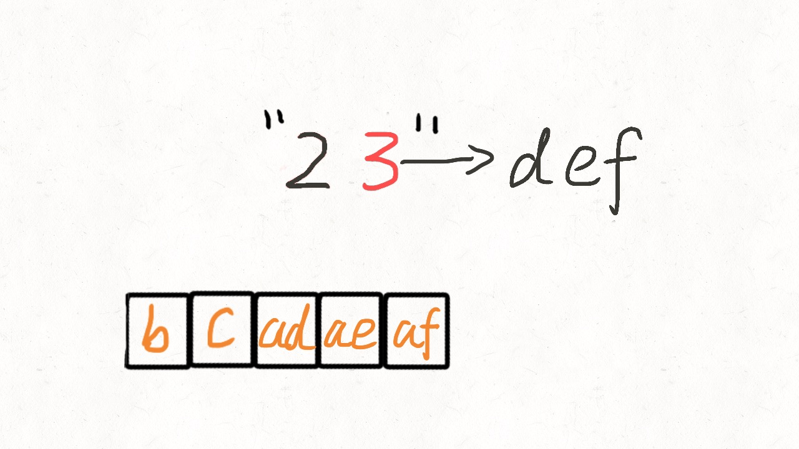
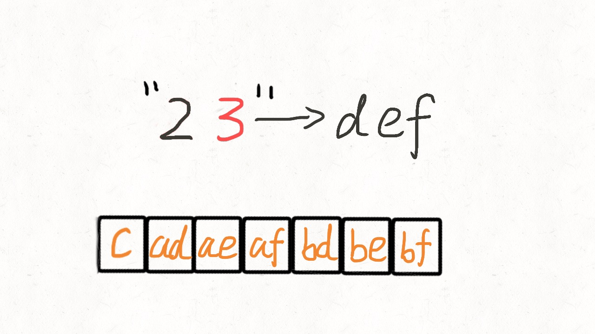
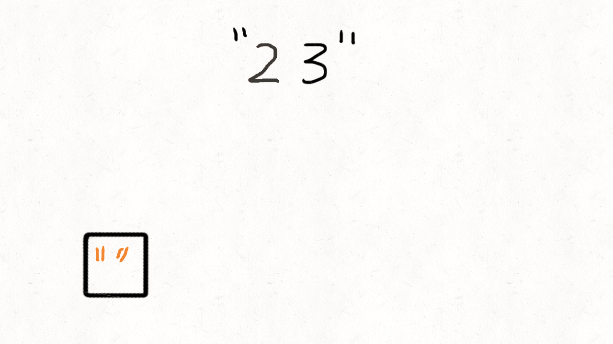

> 原文链接: https://leetcode-cn.com/problems/letter-combinations-of-a-phone-number


## 英文原文
<div><p>Given a string containing digits from <code>2-9</code> inclusive, return all possible letter combinations that the number could represent. Return the answer in <strong>any order</strong>.</p>

<p>A mapping of digit to letters (just like on the telephone buttons) is given below. Note that 1 does not map to any letters.</p>

<p></p>

<p>&nbsp;</p>
<p><strong>Example 1:</strong></p>

<pre>
<strong>Input:</strong> digits = &quot;23&quot;
<strong>Output:</strong> [&quot;ad&quot;,&quot;ae&quot;,&quot;af&quot;,&quot;bd&quot;,&quot;be&quot;,&quot;bf&quot;,&quot;cd&quot;,&quot;ce&quot;,&quot;cf&quot;]
</pre>

<p><strong>Example 2:</strong></p>

<pre>
<strong>Input:</strong> digits = &quot;&quot;
<strong>Output:</strong> []
</pre>

<p><strong>Example 3:</strong></p>

<pre>
<strong>Input:</strong> digits = &quot;2&quot;
<strong>Output:</strong> [&quot;a&quot;,&quot;b&quot;,&quot;c&quot;]
</pre>

<p>&nbsp;</p>
<p><strong>Constraints:</strong></p>

<ul>
	<li><code>0 &lt;= digits.length &lt;= 4</code></li>
	<li><code>digits[i]</code> is a digit in the range <code>[&#39;2&#39;, &#39;9&#39;]</code>.</li>
</ul>
</div>

## 中文题目
<div><p>给定一个仅包含数字&nbsp;<code>2-9</code>&nbsp;的字符串，返回所有它能表示的字母组合。答案可以按 <strong>任意顺序</strong> 返回。</p>

<p>给出数字到字母的映射如下（与电话按键相同）。注意 1 不对应任何字母。</p>

<p></p>

<p>&nbsp;</p>

<p><strong>示例 1：</strong></p>

<pre>
<strong>输入：</strong>digits = "23"
<strong>输出：</strong>["ad","ae","af","bd","be","bf","cd","ce","cf"]
</pre>

<p><strong>示例 2：</strong></p>

<pre>
<strong>输入：</strong>digits = ""
<strong>输出：</strong>[]
</pre>

<p><strong>示例 3：</strong></p>

<pre>
<strong>输入：</strong>digits = "2"
<strong>输出：</strong>["a","b","c"]
</pre>

<p>&nbsp;</p>

<p><strong>提示：</strong></p>

<ul>
	<li><code>0 &lt;= digits.length &lt;= 4</code></li>
	<li><code>digits[i]</code> 是范围 <code>['2', '9']</code> 的一个数字。</li>
</ul>
</div>

## 通过代码
<RecoDemo>
</RecoDemo>


## 高赞题解
# 回溯解法

这道题的解法是用回溯的方式，在循环里面套了递归调用。本来递归就不好理解了，再加上循环的递归，就更难理解了。

我们先不考虑递归，先看看下面这个问题怎么解决。

假设输入是2，只有一个字符，那么应该怎么解呢？

按照题目要求2=“abc"，所以结果应该是```["a","b","c"]```

先不用想着怎么去写递归，只思考下怎么打印出这个结果。

这个太简单了，一个循环就搞定了：

```java

result = List()

for(i=0;i<len("abc");i++) {

    tmp = i

    result.add(tmp)

}

return result

```

上面是伪代码，一个循环就搞定了。

如果输入的是23，应该怎么做呢？23的结果是```["ad", "ae", "af", "bd", "be", "bf", "cd", "ce", "cf"]```，我们仍然不考虑怎么去写递归，只是考虑怎么把这个结果给弄出来。代码如下：

```java

result = List()

for(i=0;i<len("abc");i++) {

    for(j=0;j<len("def");j++)

        tmp = i+j

        result.add(tmp)

}

return result

```

也就是说23这样的长度为2的字符串可以用两层循环搞定。

如果输入的是234呢，仍然不要考虑怎么去写递归，而是想怎么把结果打印出来。

```java

result = List()

for(i=0;i<len("abc");i+=1) {

    for(j=0;j<len("def");j+=1) {

        for(k=0;k<len("ghi");k+=1) {

            tmp = i+j+k

            result.add(tmp)

        }

    }

}

return result

```

这次用了三层循环。

如果输入的是2345，那么代码可以这么写：

```java

result = List()

for(i=0;i<len("abc");i+=1) {

    for(j=0;j<len("def");j+=1) {

        for(k=0;k<len("ghi");k+=1) {

            for(n=0;n<len("jkl");n+=1)

                tmp = i+j+k+n

                result.add(tmp)

        }

    }

}

return result

```

这次是用了四层循环。现在是不是能看出一些门道了？对的。循环的嵌套层数，就是输入的字符串长度。输入的字符串长度是1，循环只有1层。

输入的字符串长度是3，循环就是3层。如果输入的字符串长度是10，那么循环就是10层。

可是输入的字符串长度是不固定的，对应的循环的嵌套层数也是不固定的，那这种情况怎么解决呢？这时候递归就派上用场了。

.jpg)


对于打印"2345"这样的字符串：

第一次递归就是上图中最下面的方格，然后处理完第一个字符2之后，将输入的字符改变成"345"并调用第二个递归函数

第二次递归处理3，将字符串改变成"45"后再次递归

第三次递归处理4，将字符串改变成"5"后继续递归

第四次递归处理5，将字符串改变成""后继续递归

最后发现字符串为空了，将结果放到列表中并返回

上面是从函数调用的角度去看的，而每次调用下一层递归时，都需要将本层的一些处理结果放到一个临时变量中，再传递给下一层，从这个变量层层传递的变化看，就像一棵树一样，这个算法的时间复杂度很高，是O(3^n)这个级别的，空间复杂度是O(n)

.jpg)


动态图如下：




代码实现：

```java []

class Solution {

	//一个映射表，第二个位置是"abc“,第三个位置是"def"。。。

	//这里也可以用map，用数组可以更节省点内存

	String[] letter_map = {" ","*","abc","def","ghi","jkl","mno","pqrs","tuv","wxyz"};

	public List<String> letterCombinations(String digits) {

		//注意边界条件

		if(digits==null || digits.length()==0) {

			return new ArrayList<>();

		}

		iterStr(digits, new StringBuilder(), 0);

		return res;

	}

	//最终输出结果的list

	List<String> res = new ArrayList<>();

	

	//递归函数

	void iterStr(String str, StringBuilder letter, int index) {

		//递归的终止条件，注意这里的终止条件看上去跟动态演示图有些不同，主要是做了点优化

		//动态图中是每次截取字符串的一部分，"234"，变成"23"，再变成"3"，最后变成""，这样性能不佳

		//而用index记录每次遍历到字符串的位置，这样性能更好

		if(index == str.length()) {

			res.add(letter.toString());

			return;

		}

		//获取index位置的字符，假设输入的字符是"234"

		//第一次递归时index为0所以c=2，第二次index为1所以c=3，第三次c=4

		//subString每次都会生成新的字符串，而index则是取当前的一个字符，所以效率更高一点

		char c = str.charAt(index);

		//map_string的下表是从0开始一直到9， c-'0'就可以取到相对的数组下标位置

		//比如c=2时候，2-'0'，获取下标为2,letter_map[2]就是"abc"

		int pos = c - '0';

		String map_string = letter_map[pos];

		//遍历字符串，比如第一次得到的是2，页就是遍历"abc"

		for(int i=0;i<map_string.length();i++) {

			//调用下一层递归，用文字很难描述，请配合动态图理解

            letter.append(map_string.charAt(i));

            //如果是String类型做拼接效率会比较低

			//iterStr(str, letter+map_string.charAt(i), index+1);

            iterStr(str, letter, index+1);

            letter.deleteCharAt(letter.length()-1);

		}

	}

}

```

```python []

class Solution(object):

	def letterCombinations(self, digits):

		"""

		:type digits: str

		:rtype: List[str]

		"""

		# 注意边界条件

		if not digits:

			return []

		# 一个映射表，第二个位置是"abc“,第三个位置是"def"。。。

		# 这里也可以用map，用数组可以更节省点内存

		d = [" ","*","abc","def","ghi","jkl","mno","pqrs","tuv","wxyz"]

		# 最终输出结果的list

		res = []

		

		# 递归函数

		def dfs(tmp,index):

			# 递归的终止条件，注意这里的终止条件看上去跟动态演示图有些不同，主要是做了点优化

			# 动态图中是每次截取字符串的一部分，"234"，变成"23"，再变成"3"，最后变成""，这样性能不佳

			# 而用index记录每次遍历到字符串的位置，这样性能更好

			if index==len(digits):

				res.append(tmp)

				return

			# 获取index位置的字符，假设输入的字符是"234"

			# 第一次递归时index为0所以c=2，第二次index为1所以c=3，第三次c=4

			# subString每次都会生成新的字符串，而index则是取当前的一个字符，所以效率更高一点

			c = digits[index]

			# map_string的下表是从0开始一直到9， ord(c)-48 是获取c的ASCII码然后-48,48是0的ASCII

			# 比如c=2时候，2-'0'，获取下标为2,letter_map[2]就是"abc"

			letters = d[ord(c)-48]

			

			# 遍历字符串，比如第一次得到的是2，页就是遍历"abc"

			for i in letters:

				# 调用下一层递归，用文字很难描述，请配合动态图理解

				dfs(tmp+i,index+1)

		dfs("",0)

		return res

```


代码实现时有个小细节，如果是纯字符串拼接，会生成很多临时对象，性能会略差，Java实现中是用StringBuilder做拼接的，经测试耗时0毫秒，如果是用String类型做拼接耗时是6毫秒。感谢 [@shi-guang-ren-ran-3](/u/shi-guang-ren-ran-3/) 的提醒。

   

   

   

# 利用队列求解


我们可以利用队列的先进先出特点，再配合循环完成题目要求。

我们先将2对应的字符"a","b","c"依次放入队列中




之后再从队列中拿出第一个元素"a"，跟3对应的字符"d","e","f"挨个拼接


于是队列就变成了下面这个样子：




按照同样的方式，再将"b"从队列中拿出，再跟3对应的字符"d","e","f"挨个拼接，队列又变成下面这个样子：




动态演示如下：




代码实现：

```java []

class Solution {

	public List<String> letterCombinations(String digits) {

		if(digits==null || digits.length()==0) {

			return new ArrayList<String>();

		}

		//一个映射表，第二个位置是"abc“,第三个位置是"def"。。。

		//这里也可以用map，用数组可以更节省点内存

		String[] letter_map = {

			" ","*","abc","def","ghi","jkl","mno","pqrs","tuv","wxyz"

		};

		List<String> res = new ArrayList<>();

		//先往队列中加入一个空字符

		res.add("");

		for(int i=0;i<digits.length();i++) {

			//由当前遍历到的字符，取字典表中查找对应的字符串

			String letters = letter_map[digits.charAt(i)-'0'];

			int size = res.size();

			//计算出队列长度后，将队列中的每个元素挨个拿出来

			for(int j=0;j<size;j++) {

				//每次都从队列中拿出第一个元素

				String tmp = res.remove(0);

				//然后跟"def"这样的字符串拼接，并再次放到队列中

				for(int k=0;k<letters.length();k++) {

					res.add(tmp+letters.charAt(k));

				}

			}

		}

		return res;

	}

}

```

```python []

class Solution(object):

	def letterCombinations(self, digits):

		"""

		:type digits: str

		:rtype: List[str]

		"""	

		if not digits:

			return []

		# 一个映射表，第二个位置是"abc“,第三个位置是"def"。。。

		# 这里也可以用map，用数组可以更节省点内存

		d = [" ","*","abc","def","ghi","jkl","mno","pqrs","tuv","wxyz"]

		# 先往队列中加入一个空字符

		res = [""]

		for i in digits:

			size = len(res)

			# 由当前遍历到的字符，取字典表中查找对应的字符串

			letters = d[ord(i)-48]

			# 计算出队列长度后，将队列中的每个元素挨个拿出来

			for _ in xrange(size):

				# 每次都从队列中拿出第一个元素

				tmp = res.pop(0)

				# 然后跟"def"这样的字符串拼接，并再次放到队列中

				for j in letters:

					res.append(tmp+j)

		return res

```

**如果能再点个赞👍👍 就更感激啦💓💓**


回溯相关文章汇总   

   

| 题目 | 题解 | 难度等级 

|---| --- | --- |

|[全排列](https://leetcode-cn.com/problems/permutations/) | [两种实现+图解](https://leetcode-cn.com/problems/permutations/solution/liang-chong-shi-xian-xiang-xi-tu-jie-46quan-pai-li/) | 中等 |    

|[括号生成](https://leetcode-cn.com/problems/generate-parentheses/) | [两种实现+图解](https://leetcode-cn.com/problems/generate-parentheses/solution/dong-hua-yan-shi-22-gua-hao-sheng-cheng-by-user743/) | 中等 |    

|[电话号码的字母组合](https://leetcode-cn.com/problems/letter-combinations-of-a-phone-number/) | [两种实现+图解](https://leetcode-cn.com/problems/letter-combinations-of-a-phone-number/solution/tong-su-yi-dong-dong-hua-yan-shi-17-dian-hua-hao-m/) | 中等 |    

|[复原IP地址](https://leetcode-cn.com/problems/restore-ip-addresses/) | [两种实现+图解](https://leetcode-cn.com/problems/restore-ip-addresses/solution/tu-jie-93-fu-yuan-ipdi-zhi-by-wang_ni_ma/) | 中等 |    

|[N 皇后](https://leetcode-cn.com/problems/n-queens/) | [两种实现+图解](https://leetcode-cn.com/problems/n-queens/solution/liang-chong-shi-xian-xiang-xi-tu-jie-51-n-huang-ho/) | 困难 | 


## 统计信息
| 通过次数 | 提交次数 | AC比率 |
| :------: | :------: | :------: |
|    370462    |    645124    |   57.4%   |

## 提交历史
| 提交时间 | 提交结果 | 执行时间 |  内存消耗  | 语言 |
| :------: | :------: | :------: | :--------: | :--------: |


## 相似题目
|                             题目                             | 难度 |
| :----------------------------------------------------------: | :---------: |
| [括号生成](https://leetcode-cn.com/problems/generate-parentheses/) | 中等|
| [组合总和](https://leetcode-cn.com/problems/combination-sum/) | 中等|
| [二进制手表](https://leetcode-cn.com/problems/binary-watch/) | 简单|
