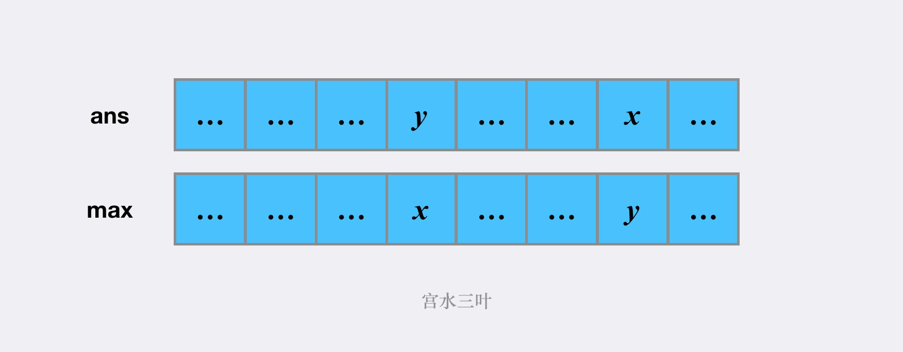
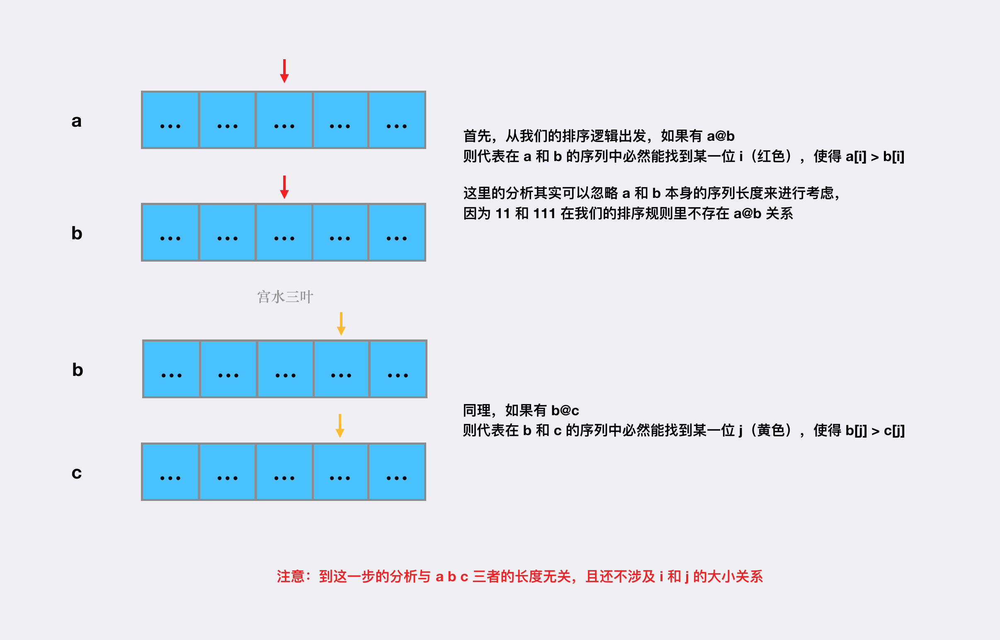
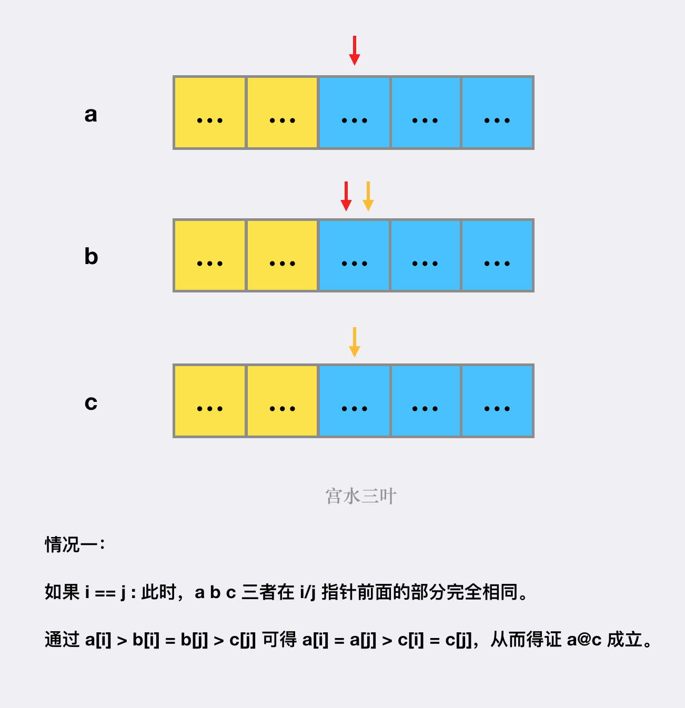
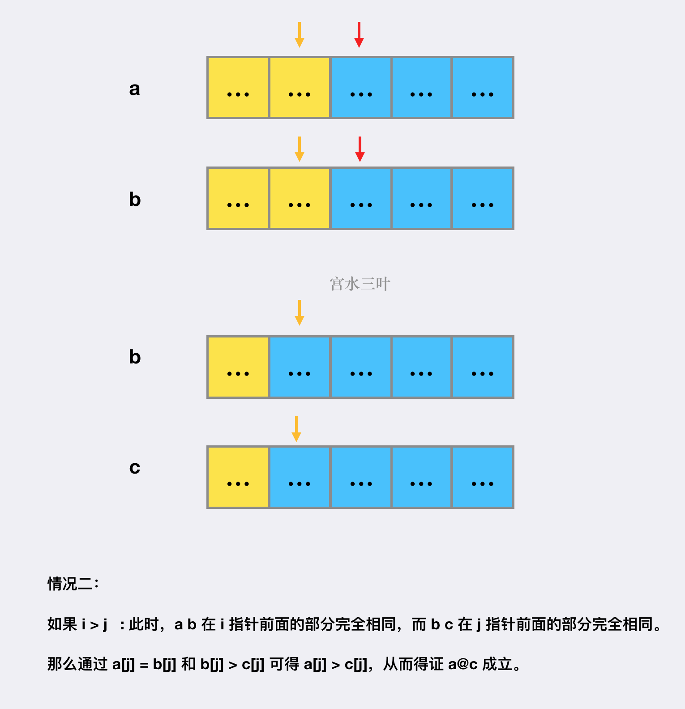
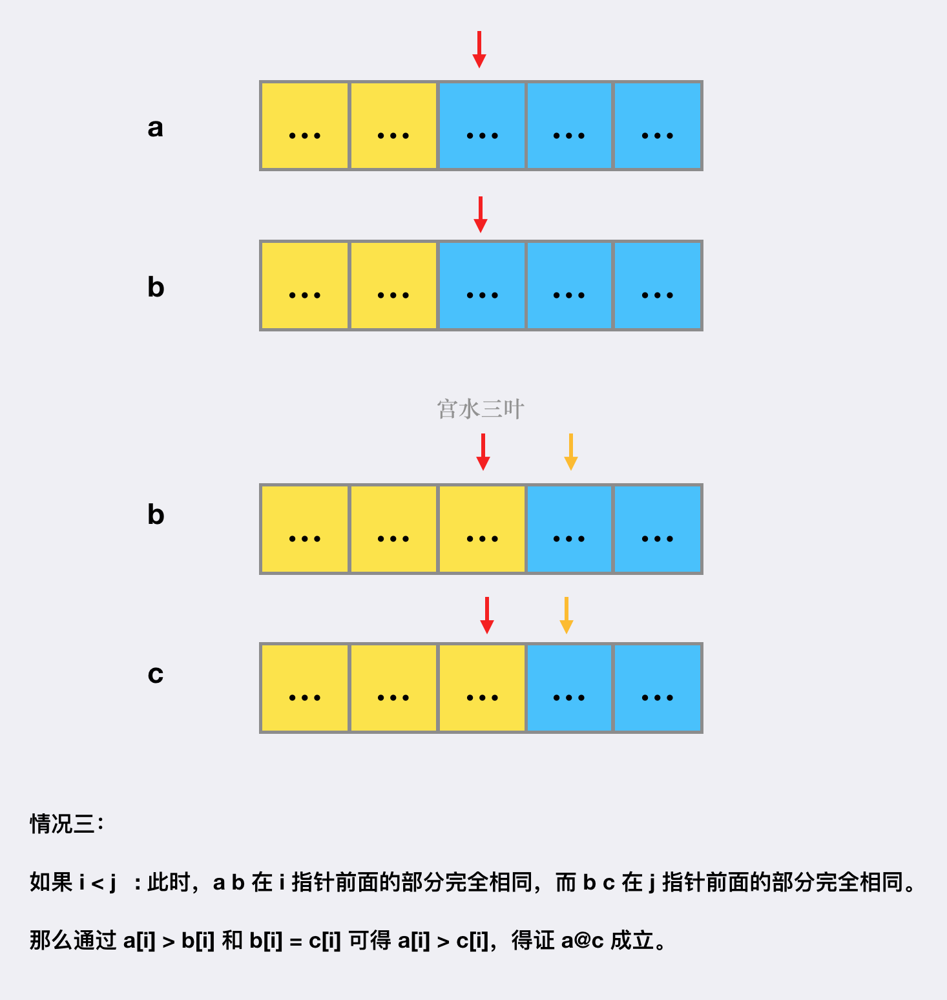

> 原文链接: https://leetcode-cn.com/problems/largest-number


## 英文原文
<div><p>Given a list of non-negative integers <code>nums</code>, arrange them such that they form the largest number.</p>

<p><strong>Note:</strong> The result may be very large, so you need to return a string instead of an integer.</p>

<p>&nbsp;</p>
<p><strong>Example 1:</strong></p>

<pre>
<strong>Input:</strong> nums = [10,2]
<strong>Output:</strong> &quot;210&quot;
</pre>

<p><strong>Example 2:</strong></p>

<pre>
<strong>Input:</strong> nums = [3,30,34,5,9]
<strong>Output:</strong> &quot;9534330&quot;
</pre>

<p><strong>Example 3:</strong></p>

<pre>
<strong>Input:</strong> nums = [1]
<strong>Output:</strong> &quot;1&quot;
</pre>

<p><strong>Example 4:</strong></p>

<pre>
<strong>Input:</strong> nums = [10]
<strong>Output:</strong> &quot;10&quot;
</pre>

<p>&nbsp;</p>
<p><strong>Constraints:</strong></p>

<ul>
	<li><code>1 &lt;= nums.length &lt;= 100</code></li>
	<li><code>0 &lt;= nums[i] &lt;= 10<sup>9</sup></code></li>
</ul>
</div>

## 中文题目
<div><p>给定一组非负整数 <code>nums</code>，重新排列每个数的顺序（每个数不可拆分）使之组成一个最大的整数。</p>

<p><strong>注意：</strong>输出结果可能非常大，所以你需要返回一个字符串而不是整数。</p>

<p> </p>

<p><strong>示例 1：</strong></p>

<pre>
<strong>输入<code>：</code></strong><code>nums = [10,2]</code>
<strong>输出：</strong><code>"210"</code></pre>

<p><strong>示例 2：</strong></p>

<pre>
<strong>输入<code>：</code></strong><code>nums = [3,30,34,5,9]</code>
<strong>输出：</strong><code>"9534330"</code>
</pre>

<p><strong>示例 3：</strong></p>

<pre>
<strong>输入<code>：</code></strong>nums = [1]
<strong>输出：</strong>"1"
</pre>

<p><strong>示例 4：</strong></p>

<pre>
<strong>输入<code>：</code></strong>nums = [10]
<strong>输出：</strong>"10"
</pre>

<p> </p>

<p><strong>提示：</strong></p>

<ul>
	<li><code>1 <= nums.length <= 100</code></li>
	<li><code>0 <= nums[i] <= 10<sup>9</sup></code></li>
</ul>
</div>

## 通过代码
<RecoDemo>
</RecoDemo>


## 高赞题解
## 贪心解法

对于 $nums$ 中的任意两个值 $a$ 和 $b$，我们无法直接从常规角度上确定其大小/先后关系。

但我们可以根据「结果」来决定 $a$ 和 $b$ 的排序关系：

如果拼接结果 $ab$ 要比 $ba$ 好，那么我们会认为 $a$ 应该放在 $b$ 前面。

另外，注意我们需要处理前导零（最多保留一位）。

**代码（感谢 [@Quaint](/u/quaint/)、[@宫水三叶的小迷妹](/u/san_ye_fen/) 和 [@天](/u/tian-et/) 三位同学提供的其他语言版本）：**
```java []
class Solution {
    public String largestNumber(int[] nums) {
        int n = nums.length;
        String[] ss = new String[n];
        for (int i = 0; i < n; i++) ss[i] = "" + nums[i];
        Arrays.sort(ss, (a, b) -> {
            String sa = a + b, sb = b + a ;
            return sb.compareTo(sa);
        });
        
        StringBuilder sb = new StringBuilder();
        for (String s : ss) sb.append(s);
        int len = sb.length();
        int k = 0;
        while (k < len - 1 && sb.charAt(k) == '0') k++;
        return sb.substring(k);
    }
}
```
```c++ []
class Solution {
public:
    string largestNumber(vector<int>& nums) {
        vector<string> str;
        for(auto i : nums) {
            str.push_back(to_string(i));
        }
        // 使用 lambda 比较 elements.
        auto cmp = [](string left, string right) {
            return left + right > right + left;
        };
        sort(str.begin(),str.end(), cmp);
        stringstream ss;
        for(auto c : str) {
            ss << c;
        }
        string ans = ss.str();
        if(ans[0] == '0'){
            return "0";
        }
        return ans;
    }
};
```
```python []
class Solution:
    def largestNumber(self, nums: List[int]) -> str:
        strs = map(str, nums)
        def cmp(a, b):
            if a + b == b + a:
                return 0
            elif a + b > b + a:
                return 1
            else:
                return -1
        strs = sorted(strs, key=functools.cmp_to_key(cmp), reverse=True)
        return ''.join(strs) if strs[0] != '0' else '0'
```
```c# []
public class Solution {
    public string LargestNumber(int[] nums) {
        string[] ss = new string[nums.Length];
        int i = 0;
        foreach (int num in nums)
        {
            ss[i++] = "" + num;
        }
        Array.Sort(ss, (a, b) =>
        {
            string sa = a + b, sb = b + a;
            return sb.CompareTo(sa);
        });
        StringBuilder sb = new StringBuilder();
        foreach (string s in ss) sb.Append(s);
        int len = sb.Length;
        int k = 0;
        while (k < len-1 && sb[k] == '0') k++;
        return sb.ToString(k,len-k);
    }
}
```
* 时间复杂度：由于是对 $String$ 进行排序，当排序对象不是 $Java$ 中的基本数据类型时，不会使用快排（考虑排序稳定性问题）。`Arrays.sort()` 的底层实现会「元素数量/元素是否大致有序」决定是使用插入排序还是归并排序。这里直接假定使用的是「插入排序」。复杂度为 $O(n^2)$
* 空间复杂度：$O(n)$

***

## 证明

上述解法，我们需要证明两个内容：

* 该贪心策略能取到全局最优解。
* 这样的「排序比较逻辑」应用在集合 $nums$ 上具有[「全序关系」](https://baike.baidu.com/item/%E5%85%A8%E5%BA%8F%E5%85%B3%E7%B3%BB)。

### 1. 该贪心策略能取到全局最优解

令我们经过这样的贪心操作得到的贪心解为 $ans$，真实最优解为 $max$。

由于真实最优解为全局最大值，而我们的贪心解至少是一个合法解（一个数），因此天然有 $ans \leqslant max$。

**接下来我们只需要证明 $ans \geqslant max$，即可得 $ans = max$（贪心解即为最优解）。**

我们使用「反证法」来证明 $ans \geqslant max$ 成立：

假设 $ans \geqslant max$ 不成立，即有 $ans < max$。

$ans$ 和 $max$ 都是由同样一批数字凑成的，如果有 $ans < max$。

这意味着我们可以将 $ans$ 中的某些低位数字和高位数字互换，使得 $ans$ 更大（调整为 $max$），这与我们根据「结果」进行排序的逻辑冲突。

因此 $ans < max$ 必然不成立，得证 $ans \geqslant max$ 成立，结合 $ans \leqslant max$ 可得贪心解为最优。

举个🌰，如果有 $ans < max$，那么意味着在 $ans$ 中至少有一对数字互换可以使得 $ans$ 变大，

那么在排序逻辑中 $x$ 所在的整体（可能不只有 $x$ 一个数）应该被排在 $y$ 所在的整体（可能不只有 $y$ 一个数）前面。




### 2. 全序关系

我们使用符号 $@$ 来代指我们的「排序」逻辑：

* 如果 $a$ 必须排在 $b$ 的前面，我们记作 $a @ b$；
* 如果 $a$ 必须排在 $b$ 的后面，我们记作 $b @ a$；
* 如果 $a$ 既可以排在 $b$ 的前面，也可以排在 $b$ 的后面，我们记作 $a#b$；

**2.1 完全性**

**具有完全性是指从集合 $nums$ 中任意取出两个元素 $a$ 和 $b$，必然满足 $a @ b$、$b @ a$ 和 $a#b$ 三者之一。**

**这点其实不需要额外证明，因为由 $a$ 和 $b$ 拼接的字符串 $ab$ 和 $ba$ 所在「字典序大小关系中」要么完全相等，要么具有明确的字典序大小关系，导致 $a$ 必须排在前面或者后面。**

**2.2 反对称性**

**具有反对称性是指由 $a@b$ 和 $b@a$ 能够推导出 $a#b$。**

$a@b$ 说明字符串 $ab$ 的字典序大小数值要比字符串 $ba$ 字典序大小数值大。

$b@a$ 说明字符串 $ab$ 的字典序大小数值要比字符串 $ba$ 字典序大小数值小。

**这样，基于「字典序本身满足全序关系」和「数学上的 $a \geqslant b$ 和 $a \leqslant b$ 可推导出 $a = b$」。**

**得证 $a@b$ 和 $b@a$ 能够推导出 $a#b$。**

**2.3 传递性**

**具有传递性是指由 $a@b$ 和 $b@c$ 能够推导出 $a@c$。**

这里的「传递性」其实也可以使用与 [官方题解](https://leetcode-cn.com/problems/largest-number/solution/zui-da-shu-by-leetcode-solution-sid5/) 类似的手法来证明。

**我们可以利用「两个等长的拼接字符串，字典序大小关系与数值大小关系一致」这一性质来证明，因为字符串 $ac$ 和 $ca$ 必然是等长的。**

接下来，让我们从「自定义排序逻辑」出发，换个思路来证明 $a@c$：




**然后我们只需要证明在不同的 $i$ $j$ 关系之间（共三种情况），$a@c$ 恒成立即可：**


1. 当 $i == j$ 的时候：




2. 当 $i > j$ 的时候：




3. 当 $i < j$ 的时候：




**综上，我们证明了无论在何种情况下，只要有 $a@b$ 和 $b@c$ 的话，那么 $a@c$ 恒成立。**

**我们之所以能这样证明「传递性」，本质是利用了自定义排序逻辑中「对于确定任意元素 $a$ 和 $b$ 之间的排序关系只依赖于 $a$ 和 $b$ 的第一个不同元素之间的大小关系」这一性质。**

***

## 找 $i$ 的越界问题（感谢 [@Die Eule](/u/pleviumtan/) 同学的补充）

考虑

(1) a = 304 b = 30
(2) a = 301 b = 30

两种情况。

显然，（1）下我们会得到 $a@b$，而（2）下我们会得到 $b@a$

但是，在这种情况下 $i$ 实际上位于 $b$ 界外，那我们还能不能找 $i$ 呢？$b[i]$ 是多少呢？

实际上是可以的，我们在比较 $a$ 和 $b$ 的时候，实际上是在比较 $ab$ 和 $ba$ 两个字符串，所以实际上我们是在用 $a[0]$, $a[1]$, $a[2]$ ... 去填补 $b$ 本体结束后的空缺。换而言之（1）和（2）里的 b 实际上被填补为 `303` （填进来 $a[0]$）

再比如

（3）a = 3131248 b = 3131 ，比较的时候实际上是用 $a$ 开头的 `4` 位去填补上 $b$ 的空缺，所以 $b$ 实际上相当于 `31313131`

***

## 最后

**如果有帮助到你，请给题解点个赞和收藏，让更多的人看到 ~ ("▔□▔)/**

**如有不理解的地方，欢迎你在评论区给我留言，我都会逐一回复 ~**

也欢迎你 [关注我](https://leetcode-cn.com/u/ac_oier/) ，提供追求「证明」&「思路」的高质量题解  

## 统计信息
| 通过次数 | 提交次数 | AC比率 |
| :------: | :------: | :------: |
|    127891    |    312193    |   41.0%   |

## 提交历史
| 提交时间 | 提交结果 | 执行时间 |  内存消耗  | 语言 |
| :------: | :------: | :------: | :--------: | :--------: |
