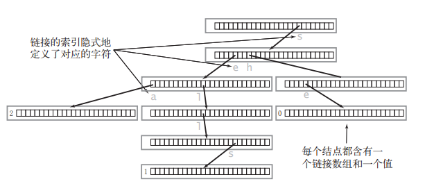
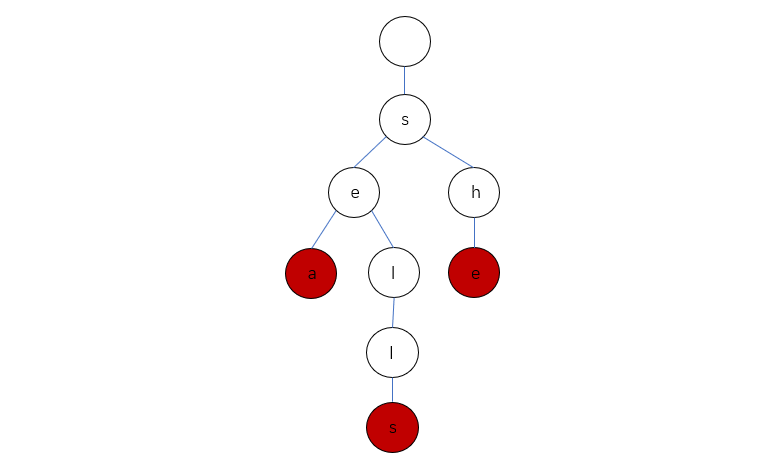

> 原文链接: https://leetcode-cn.com/problems/implement-trie-prefix-tree


## 英文原文
<div><p>A <a href="https://en.wikipedia.org/wiki/Trie" target="_blank"><strong>trie</strong></a> (pronounced as &quot;try&quot;) or <strong>prefix tree</strong> is a tree data structure used to efficiently store and retrieve keys in a dataset of strings. There are various applications of this data structure, such as autocomplete and spellchecker.</p>

<p>Implement the Trie class:</p>

<ul>
	<li><code>Trie()</code> Initializes the trie object.</li>
	<li><code>void insert(String word)</code> Inserts the string <code>word</code> into the trie.</li>
	<li><code>boolean search(String word)</code> Returns <code>true</code> if the string <code>word</code> is in the trie (i.e., was inserted before), and <code>false</code> otherwise.</li>
	<li><code>boolean startsWith(String prefix)</code> Returns <code>true</code> if there is a previously inserted string <code>word</code> that has the prefix <code>prefix</code>, and <code>false</code> otherwise.</li>
</ul>

<p>&nbsp;</p>
<p><strong>Example 1:</strong></p>

<pre>
<strong>Input</strong>
[&quot;Trie&quot;, &quot;insert&quot;, &quot;search&quot;, &quot;search&quot;, &quot;startsWith&quot;, &quot;insert&quot;, &quot;search&quot;]
[[], [&quot;apple&quot;], [&quot;apple&quot;], [&quot;app&quot;], [&quot;app&quot;], [&quot;app&quot;], [&quot;app&quot;]]
<strong>Output</strong>
[null, null, true, false, true, null, true]

<strong>Explanation</strong>
Trie trie = new Trie();
trie.insert(&quot;apple&quot;);
trie.search(&quot;apple&quot;);   // return True
trie.search(&quot;app&quot;);     // return False
trie.startsWith(&quot;app&quot;); // return True
trie.insert(&quot;app&quot;);
trie.search(&quot;app&quot;);     // return True
</pre>

<p>&nbsp;</p>
<p><strong>Constraints:</strong></p>

<ul>
	<li><code>1 &lt;= word.length, prefix.length &lt;= 2000</code></li>
	<li><code>word</code> and <code>prefix</code> consist only of lowercase English letters.</li>
	<li>At most <code>3 * 10<sup>4</sup></code> calls <strong>in total</strong> will be made to <code>insert</code>, <code>search</code>, and <code>startsWith</code>.</li>
</ul>
</div>

## 中文题目
<div><p><strong><a href="https://baike.baidu.com/item/字典树/9825209?fr=aladdin" target="_blank">Trie</a></strong>（发音类似 "try"）或者说 <strong>前缀树</strong> 是一种树形数据结构，用于高效地存储和检索字符串数据集中的键。这一数据结构有相当多的应用情景，例如自动补完和拼写检查。</p>

<p>请你实现 Trie 类：</p>

<ul>
	<li><code>Trie()</code> 初始化前缀树对象。</li>
	<li><code>void insert(String word)</code> 向前缀树中插入字符串 <code>word</code> 。</li>
	<li><code>boolean search(String word)</code> 如果字符串 <code>word</code> 在前缀树中，返回 <code>true</code>（即，在检索之前已经插入）；否则，返回 <code>false</code> 。</li>
	<li><code>boolean startsWith(String prefix)</code> 如果之前已经插入的字符串 <code>word</code> 的前缀之一为 <code>prefix</code> ，返回 <code>true</code> ；否则，返回 <code>false</code> 。</li>
</ul>

<p> </p>

<p><strong>示例：</strong></p>

<pre>
<strong>输入</strong>
["Trie", "insert", "search", "search", "startsWith", "insert", "search"]
[[], ["apple"], ["apple"], ["app"], ["app"], ["app"], ["app"]]
<strong>输出</strong>
[null, null, true, false, true, null, true]

<strong>解释</strong>
Trie trie = new Trie();
trie.insert("apple");
trie.search("apple");   // 返回 True
trie.search("app");     // 返回 False
trie.startsWith("app"); // 返回 True
trie.insert("app");
trie.search("app");     // 返回 True
</pre>

<p> </p>

<p><strong>提示：</strong></p>

<ul>
	<li><code>1 <= word.length, prefix.length <= 2000</code></li>
	<li><code>word</code> 和 <code>prefix</code> 仅由小写英文字母组成</li>
	<li><code>insert</code>、<code>search</code> 和 <code>startsWith</code> 调用次数 <strong>总计</strong> 不超过 <code>3 * 10<sup>4</sup></code> 次</li>
</ul>
</div>

## 通过代码
<RecoDemo>
</RecoDemo>


## 高赞题解
> Trie [traɪ] 读音和 try 相同，它的另一些名字有：字典树，前缀树，单词查找树等。


### 介绍 Trie🌳


Trie 是一颗非典型的多叉树模型，多叉好理解，即每个结点的分支数量可能为多个。


为什么说非典型呢？因为它和一般的多叉树不一样，尤其在结点的数据结构设计上，比如一般的多叉树的结点是这样的：


```C++ []

struct TreeNode {

    VALUETYPE value;    //结点值

    TreeNode* children[NUM];    //指向孩子结点

};

```


而 Trie 的结点是这样的(假设只包含'a'~'z'中的字符)：


```C++ []

struct TrieNode {

    bool isEnd; //该结点是否是一个串的结束

    TrieNode* next[26]; //字母映射表

};

```


要想学会 Trie 就得先明白它的结点设计。我们可以看到`TrieNode`结点中并没有直接保存字符值的数据成员，那它是怎么保存字符的呢？


这时**字母映射表`next`** 的妙用就体现了，`TrieNode* next[26]`中保存了对当前结点而言下一个可能出现的所有字符的链接，因此我们可以通过一个父结点来预知它所有子结点的值：


```C++ []

for (int i = 0; i < 26; i++) {

    char ch = 'a' + i;

    if (parentNode->next[i] == NULL) {

        说明父结点的后一个字母不可为 ch

    } else {

        说明父结点的后一个字母可以是 ch

    }

}

```


我们来看个例子吧。


想象以下，包含三个单词 "sea","sells","she" 的 Trie 会长啥样呢？


它的真实情况是这样的：





Trie 中一般都含有大量的空链接，因此在绘制一棵单词查找树时一般会忽略空链接，同时为了方便理解我们可以画成这样：





接下来我们一起来实现对 Trie 的一些常用操作方法。


---


#### 定义类 Trie


```C++ []

class Trie {

private:

    bool isEnd;

    Trie* next[26];

public:

    //方法将在下文实现...

};

```


#### 插入


描述：向 Trie 中插入一个单词 word


实现：这个操作和构建链表很像。首先从根结点的子结点开始与 word 第一个字符进行匹配，一直匹配到前缀链上没有对应的字符，这时开始不断开辟新的结点，直到插入完 word 的最后一个字符，同时还要将最后一个结点`isEnd = true;`，表示它是一个单词的末尾。


```C++ []

void insert(string word) {

    Trie* node = this;

    for (char c : word) {

        if (node->next[c-'a'] == NULL) {

            node->next[c-'a'] = new Trie();

        }

        node = node->next[c-'a'];

    }

    node->isEnd = true;

}

```


#### 查找


描述：查找 Trie 中是否存在单词 word


实现：从根结点的子结点开始，一直向下匹配即可，如果出现结点值为空就返回 `false`，如果匹配到了最后一个字符，那我们只需判断 `node->isEnd`即可。


```C++ []

bool search(string word) {

    Trie* node = this;

    for (char c : word) {

        node = node->next[c - 'a'];

        if (node == NULL) {

            return false;

        }

    }

    return node->isEnd;

}

```


#### 前缀匹配


描述：判断 Trie 中是或有以 prefix 为前缀的单词


实现：和 search 操作类似，只是不需要判断最后一个字符结点的`isEnd`，因为既然能匹配到最后一个字符，那后面一定有单词是以它为前缀的。


```C++ []

bool startsWith(string prefix) {

    Trie* node = this;

    for (char c : prefix) {

        node = node->next[c-'a'];

        if (node == NULL) {

            return false;

        }

    }

    return true;

}

```


---


到这我们就已经实现了对 Trie 的一些基本操作，这样我们对 Trie 就有了进一步的理解。完整代码我贴在了文末。


### 总结


通过以上介绍和代码实现我们可以总结出 Trie 的几点性质：


1. Trie 的形状和单词的插入或删除顺序无关，也就是说对于任意给定的一组单词，Trie 的形状都是唯一的。


2. 查找或插入一个长度为 L 的单词，访问 next 数组的次数最多为 L+1，**和 Trie 中包含多少个单词无关**。


3. Trie 的每个结点中都保留着一个字母表，这是很耗费空间的。如果 Trie 的高度为 n，字母表的大小为 m，最坏的情况是 Trie 中还不存在前缀相同的单词，那空间复杂度就为 $O(m^n)$。


最后，关于 Trie 的应用场景，希望你能记住 8 个字：**一次建树，多次查询**。(慢慢领悟叭~~)


### 全部代码


```C++ []

class Trie {

private:

    bool isEnd;

    Trie* next[26];

public:

    Trie() {

        isEnd = false;

        memset(next, 0, sizeof(next));

    }

    

    void insert(string word) {

        Trie* node = this;

        for (char c : word) {

            if (node->next[c-'a'] == NULL) {

                node->next[c-'a'] = new Trie();

            }

            node = node->next[c-'a'];

        }

        node->isEnd = true;

    }

    

    bool search(string word) {

        Trie* node = this;

        for (char c : word) {

            node = node->next[c - 'a'];

            if (node == NULL) {

                return false;

            }

        }

        return node->isEnd;

    }

    

    bool startsWith(string prefix) {

        Trie* node = this;

        for (char c : prefix) {

            node = node->next[c-'a'];

            if (node == NULL) {

                return false;

            }

        }

        return true;

    }

};


```


### 最后


至此，您已经掌握了 Trie 树的实现以及对它的一些基本操作，感谢您的观看！


## 统计信息
| 通过次数 | 提交次数 | AC比率 |
| :------: | :------: | :------: |
|    156090    |    217518    |   71.8%   |

## 提交历史
| 提交时间 | 提交结果 | 执行时间 |  内存消耗  | 语言 |
| :------: | :------: | :------: | :--------: | :--------: |


## 相似题目
|                             题目                             | 难度 |
| :----------------------------------------------------------: | :---------: |
| [添加与搜索单词 - 数据结构设计](https://leetcode-cn.com/problems/design-add-and-search-words-data-structure/) | 中等|
| [设计搜索自动补全系统](https://leetcode-cn.com/problems/design-search-autocomplete-system/) | 困难|
| [单词替换](https://leetcode-cn.com/problems/replace-words/) | 中等|
| [实现一个魔法字典](https://leetcode-cn.com/problems/implement-magic-dictionary/) | 中等|
