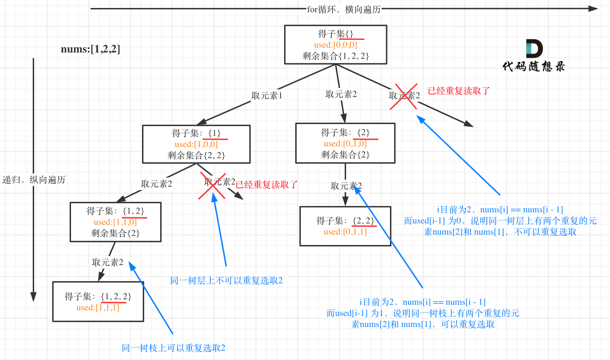

> 原文链接: https://leetcode-cn.com/problems/subsets-ii


## 英文原文
<div><p>Given an integer array <code>nums</code> that may contain duplicates, return <em>all possible subsets (the power set)</em>.</p>

<p>The solution set <strong>must not</strong> contain duplicate subsets. Return the solution in <strong>any order</strong>.</p>

<p>&nbsp;</p>
<p><strong>Example 1:</strong></p>
<pre><strong>Input:</strong> nums = [1,2,2]
<strong>Output:</strong> [[],[1],[1,2],[1,2,2],[2],[2,2]]
</pre><p><strong>Example 2:</strong></p>
<pre><strong>Input:</strong> nums = [0]
<strong>Output:</strong> [[],[0]]
</pre>
<p>&nbsp;</p>
<p><strong>Constraints:</strong></p>

<ul>
	<li><code>1 &lt;= nums.length &lt;= 10</code></li>
	<li><code>-10 &lt;= nums[i] &lt;= 10</code></li>
</ul>
</div>

## 中文题目
<div><p>给你一个整数数组 <code>nums</code> ，其中可能包含重复元素，请你返回该数组所有可能的子集（幂集）。</p>

<p>解集 <strong>不能</strong> 包含重复的子集。返回的解集中，子集可以按 <strong>任意顺序</strong> 排列。</p>

<div class="original__bRMd">
<div>
<p> </p>

<p><strong>示例 1：</strong></p>

<pre>
<strong>输入：</strong>nums = [1,2,2]
<strong>输出：</strong>[[],[1],[1,2],[1,2,2],[2],[2,2]]
</pre>

<p><strong>示例 2：</strong></p>

<pre>
<strong>输入：</strong>nums = [0]
<strong>输出：</strong>[[],[0]]
</pre>

<p> </p>

<p><strong>提示：</strong></p>

<ul>
	<li><code>1 <= nums.length <= 10</code></li>
	<li><code>-10 <= nums[i] <= 10</code></li>
</ul>
</div>
</div>
</div>

## 通过代码
<RecoDemo>
</RecoDemo>


## 高赞题解


# 思路 

> **如果对回溯算法基础还不了解的话，可以看一下我的视频：[带你学透回溯算法（理论篇）B站视频](https://www.bilibili.com/video/BV1cy4y167mM/)**  结合这题解一起看，希望对你理解回溯算法有所帮助！


很多同学在去重的问题上想不明白，其实很多题解也没有讲清楚，反正代码是能过的，感觉是那么回事，稀里糊涂的先把题目过了。

这个去重为什么很难理解呢，**所谓去重，其实就是使用过的元素不能重复选取。** 这么一说好像很简单！

都知道组合问题可以抽象为树形结构，那么“使用过”在这个树形结构上是有两个维度的，一个维度是同一树枝上使用过，一个维度是同一树层上使用过。**没有理解这两个层面上的“使用过” 是造成大家没有彻底理解去重的根本原因。**

那么问题来了，我们是要同一树层上使用过，还是统一树枝上使用过呢？

回看一下题目，元素在同一个组合内是可以重复的，怎么重复都没事，但两个组合不能相同。

**所以我们要去重的是同一树层上的“使用过”，同一树枝上的都是一个组合里的元素，不用去重**。

**剧透一下，后期要讲解的排列问题里去重也是这个套路，所以理解“树层去重”和“树枝去重”非常重要**。


用示例中的[1, 2, 2] 来举例，如图所示： （**注意去重需要先对集合排序**）




从图中可以看出，同一树层上重复取2 就要过滤掉，同一树枝上就可以重复取2，因为同一树枝上元素的集合才是唯一子集！

# C++代码

```
class Solution {
private:
    vector<vector<int>> result;
    vector<int> path;
    void backtracking(vector<int>& nums, int startIndex, vector<bool>& used) {
        result.push_back(path);
        for (int i = startIndex; i < nums.size(); i++) {
            // used[i - 1] == true，说明同一树支candidates[i - 1]使用过
            // used[i - 1] == false，说明同一树层candidates[i - 1]使用过
            // 而我们要对同一树层使用过的元素进行跳过
            if (i > 0 && nums[i] == nums[i - 1] && used[i - 1] == false) {
                continue;
            }
            path.push_back(nums[i]);
            used[i] = true;
            backtracking(nums, i + 1, used);
            used[i] = false;
            path.pop_back();
        }
    }

public:
    vector<vector<int>> subsetsWithDup(vector<int>& nums) {
        result.clear();
        path.clear();
        vector<bool> used(nums.size(), false);
        sort(nums.begin(), nums.end()); // 去重需要排序
        backtracking(nums, 0, used);
        return result;
    }
};
```  


使用set去重的版本。
```
class Solution {
private:
    vector<vector<int>> result;
    vector<int> path;
    void backtracking(vector<int>& nums, int startIndex, vector<bool>& used) {
        result.push_back(path);
        unordered_set<int> uset;
        for (int i = startIndex; i < nums.size(); i++) {
            if (uset.find(nums[i]) != uset.end()) {
                continue;
            }
            uset.insert(nums[i]);
            path.push_back(nums[i]);
            backtracking(nums, i + 1, used);
            path.pop_back();
        }
    }

public:
    vector<vector<int>> subsetsWithDup(vector<int>& nums) {
        result.clear();
        path.clear();
        vector<bool> used(nums.size(), false);
        sort(nums.begin(), nums.end()); // 去重需要排序
        backtracking(nums, 0, used);
        return result;
    }
};

``` 

## 补充

本题也可以不适用used数组来去重，因为递归的时候下一个startIndex是i+1而不是0。

如果要是全排列的话，每次要从0开始遍历，为了跳过已入栈的元素，需要使用used。

代码如下：

```CPP
class Solution {
private:
    vector<vector<int>> result;
    vector<int> path;
    void backtracking(vector<int>& nums, int startIndex) {
        result.push_back(path);
        for (int i = startIndex; i < nums.size(); i++) {
            // 而我们要对同一树层使用过的元素进行跳过
            if (i > startIndex && nums[i] == nums[i - 1] ) { // 注意这里使用i > startIndex
                continue;
            }
            path.push_back(nums[i]);
            backtracking(nums, i + 1);
            path.pop_back();
        }
    }

public:
    vector<vector<int>> subsetsWithDup(vector<int>& nums) {
        result.clear();
        path.clear();
        sort(nums.begin(), nums.end()); // 去重需要排序
        backtracking(nums, 0);
        return result;
    }
};
```

## 总结

其实这道题目的知识点，我们之前都讲过了，如果之前讲过的子集问题和去重问题都掌握的好，这道题目应该分分钟AC。

当然本题去重的逻辑，也可以这么写

```
if (i > startIndex && nums[i] == nums[i - 1] ) {
        continue;
}
```


## 其他语言版本


Java：
```java
class Solution {
   List<List<Integer>> result = new ArrayList<>();// 存放符合条件结果的集合
   LinkedList<Integer> path = new LinkedList<>();// 用来存放符合条件结果
   boolean[] used;
    public List<List<Integer>> subsetsWithDup(int[] nums) {
        if (nums.length == 0){
            result.add(path);
            return result;
        }
        Arrays.sort(nums);
        used = new boolean[nums.length];
        subsetsWithDupHelper(nums, 0);
        return result;
    }
    
    private void subsetsWithDupHelper(int[] nums, int startIndex){
        result.add(new ArrayList<>(path));
        if (startIndex >= nums.length){
            return;
        }
        for (int i = startIndex; i < nums.length; i++){
            if (i > 0 && nums[i] == nums[i - 1] && !used[i - 1]){
                continue;
            }
            path.add(nums[i]);
            used[i] = true;
            subsetsWithDupHelper(nums, i + 1);
            path.removeLast();
            used[i] = false;
        }
    }
}
```

Python：
```python3
class Solution:
    def subsetsWithDup(self, nums: List[int]) -> List[List[int]]:
        res = []  #存放符合条件结果的集合
        path = []  #用来存放符合条件结果
        def backtrack(nums,startIndex):
            res.append(path[:])
            for i in range(startIndex,len(nums)):
                if i > startIndex and nums[i] == nums[i - 1]:  #我们要对同一树层使用过的元素进行跳过
                    continue
                path.append(nums[i])
                backtrack(nums,i+1)  #递归
                path.pop()  #回溯
        nums = sorted(nums)  #去重需要排序
        backtrack(nums,0)
        return res
```

Go：
```Go
var res[][]int
func subsetsWithDup(nums []int)[][]int {
	res=make([][]int,0)
	 sort.Ints(nums)
	dfs([]int{},nums,0)
	return res
}
func dfs(temp, num []int, start int)  {
	tmp:=make([]int,len(temp))
	copy(tmp,temp)

	res=append(res,tmp)
	for i:=start;i<len(num);i++{
		if i>start&&num[i]==num[i-1]{
			continue
		}
		temp=append(temp,num[i])
		dfs(temp,num,i+1)
		temp=temp[:len(temp)-1]
	}
}
```


Javascript:

```Javascript

var subsetsWithDup = function(nums) {
    let result = []
    let path = []
    let sortNums = nums.sort((a, b) => {
        return a - b
    })
    function backtracing(startIndex, sortNums) {
        result.push(path.slice(0))
        if(startIndex > nums.length - 1) {
            return
        }
        for(let i = startIndex; i < nums.length; i++) {
            if(i > startIndex && nums[i] === nums[i - 1]) {
                continue
            }
            path.push(nums[i])
            backtracing(i + 1, sortNums)
            path.pop()
        }
    }
    backtracing(0, sortNums)
    return result
};

```

# 回溯算法力扣题目总结

按照如下顺序刷力扣上的题目，相信会帮你在学习回溯算法的路上少走很多弯路。

* [关于回溯算法，你该了解这些！](https://programmercarl.com/回溯算法理论基础.html)
* 组合问题
    * [77.组合](https://programmercarl.com/0077.组合.html)
    * [216.组合总和III](https://programmercarl.com/0216.组合总和III.html)
    * [17.电话号码的字母组合](https://programmercarl.com/0017.电话号码的字母组合.html)
    * [39.组合总和](https://programmercarl.com/0039.组合总和.html)
    * [40.组合总和II](https://programmercarl.com/0040.组合总和II.html)
* 分割问题
    * [131.分割回文串](https://programmercarl.com/0131.分割回文串.html)
    * [93.复原IP地址](https://programmercarl.com/0093.复原IP地址.html)
* 子集问题 
    * [78.子集](https://programmercarl.com/0078.子集.html)
    * [90.子集II](https://programmercarl.com/0090.子集II.html)
* 排列问题
    * [46.全排列](https://programmercarl.com/0046.全排列.html)
    * [47.全排列II](https://programmercarl.com/0047.全排列II.html)
* 棋盘问题
    * [51.N皇后](https://programmercarl.com/0051.N皇后.html)
    * [37.解数独](https://programmercarl.com/0037.解数独.html)
* 其他 
    * [491.递增子序列](https://programmercarl.com/0491.递增子序列.html)
    * [332.重新安排行程](https://programmercarl.com/0332.重新安排行程.html)
* [回溯算法总结篇](https://programmercarl.com/回溯总结.html)

-----------

**大家好，我是程序员Carl，点击[我的头像](https://mp.weixin.qq.com/s/_DzddsMeQW5JPI6qoC7ARQ)**，查看力扣详细刷题攻略，你会发现相见恨晚！

**如果感觉题解对你有帮助，不要吝啬给一个👍吧！**


## 统计信息
| 通过次数 | 提交次数 | AC比率 |
| :------: | :------: | :------: |
|    149625    |    236159    |   63.4%   |

## 提交历史
| 提交时间 | 提交结果 | 执行时间 |  内存消耗  | 语言 |
| :------: | :------: | :------: | :--------: | :--------: |


## 相似题目
|                             题目                             | 难度 |
| :----------------------------------------------------------: | :---------: |
| [子集](https://leetcode-cn.com/problems/subsets/) | 中等|
