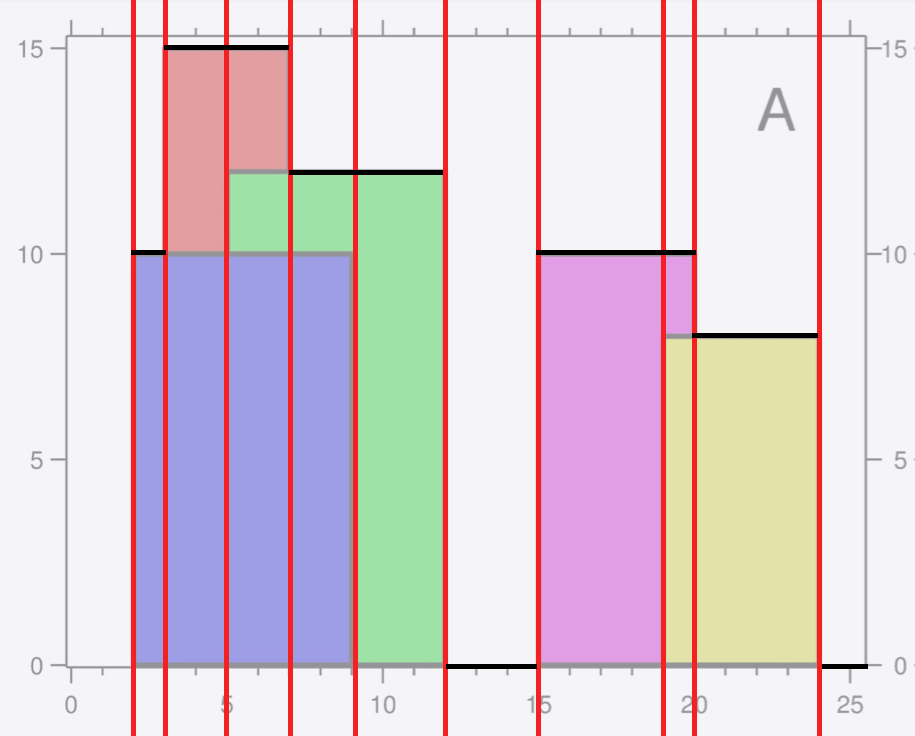
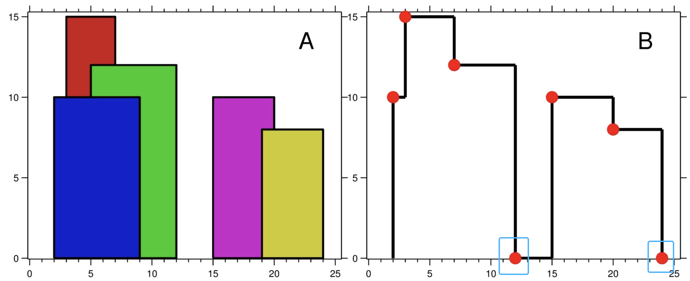

> 原文链接: https://leetcode-cn.com/problems/the-skyline-problem


## 英文原文
<div><p>A city&#39;s <strong>skyline</strong> is the outer contour of the silhouette formed by all the buildings in that city when viewed from a distance. Given the locations and heights of all the buildings, return <em>the <strong>skyline</strong> formed by these buildings collectively</em>.</p>

<p>The geometric information of each building is given in the array <code>buildings</code> where <code>buildings[i] = [left<sub>i</sub>, right<sub>i</sub>, height<sub>i</sub>]</code>:</p>

<ul>
	<li><code>left<sub>i</sub></code> is the x coordinate of the left edge of the <code>i<sup>th</sup></code> building.</li>
	<li><code>right<sub>i</sub></code> is the x coordinate of the right edge of the <code>i<sup>th</sup></code> building.</li>
	<li><code>height<sub>i</sub></code> is the height of the <code>i<sup>th</sup></code> building.</li>
</ul>

<p>You may assume all buildings are perfect rectangles grounded on an absolutely flat surface at height <code>0</code>.</p>

<p>The <strong>skyline</strong> should be represented as a list of &quot;key points&quot; <strong>sorted by their x-coordinate</strong> in the form <code>[[x<sub>1</sub>,y<sub>1</sub>],[x<sub>2</sub>,y<sub>2</sub>],...]</code>. Each key point is the left endpoint of some horizontal segment in the skyline except the last point in the list, which always has a y-coordinate <code>0</code> and is used to mark the skyline&#39;s termination where the rightmost building ends. Any ground between the leftmost and rightmost buildings should be part of the skyline&#39;s contour.</p>

<p><b>Note:</b> There must be no consecutive horizontal lines of equal height in the output skyline. For instance, <code>[...,[2 3],[4 5],[7 5],[11 5],[12 7],...]</code> is not acceptable; the three lines of height 5 should be merged into one in the final output as such: <code>[...,[2 3],[4 5],[12 7],...]</code></p>

<p>&nbsp;</p>
<p><strong>Example 1:</strong></p>

<pre>
<strong>Input:</strong> buildings = [[2,9,10],[3,7,15],[5,12,12],[15,20,10],[19,24,8]]
<strong>Output:</strong> [[2,10],[3,15],[7,12],[12,0],[15,10],[20,8],[24,0]]
<strong>Explanation:</strong>
Figure A shows the buildings of the input.
Figure B shows the skyline formed by those buildings. The red points in figure B represent the key points in the output list.
</pre>

<p><strong>Example 2:</strong></p>

<pre>
<strong>Input:</strong> buildings = [[0,2,3],[2,5,3]]
<strong>Output:</strong> [[0,3],[5,0]]
</pre>

<p>&nbsp;</p>
<p><strong>Constraints:</strong></p>

<ul>
	<li><code>1 &lt;= buildings.length &lt;= 10<sup>4</sup></code></li>
	<li><code>0 &lt;= left<sub>i</sub> &lt; right<sub>i</sub> &lt;= 2<sup>31</sup> - 1</code></li>
	<li><code>1 &lt;= height<sub>i</sub> &lt;= 2<sup>31</sup> - 1</code></li>
	<li><code>buildings</code> is sorted by <code>left<sub>i</sub></code> in&nbsp;non-decreasing order.</li>
</ul>
</div>

## 中文题目
<div><p>城市的天际线是从远处观看该城市中所有建筑物形成的轮廓的外部轮廓。给你所有建筑物的位置和高度，请返回由这些建筑物形成的<strong> 天际线</strong> 。</p>

<p>每个建筑物的几何信息由数组 <code>buildings</code> 表示，其中三元组 <code>buildings[i] = [lefti, righti, heighti]</code> 表示：</p>

<ul>
	<li><code>left<sub>i</sub></code> 是第 <code>i</code> 座建筑物左边缘的 <code>x</code> 坐标。</li>
	<li><code>right<sub>i</sub></code> 是第 <code>i</code> 座建筑物右边缘的 <code>x</code> 坐标。</li>
	<li><code>height<sub>i</sub></code> 是第 <code>i</code> 座建筑物的高度。</li>
</ul>

<p><strong>天际线</strong> 应该表示为由 “关键点” 组成的列表，格式 <code>[[x<sub>1</sub>,y<sub>1</sub>],[x<sub>2</sub>,y<sub>2</sub>],...]</code> ，并按 <strong>x 坐标 </strong>进行 <strong>排序</strong> 。<strong>关键点是水平线段的左端点</strong>。列表中最后一个点是最右侧建筑物的终点，<code>y</code> 坐标始终为 <code>0</code> ，仅用于标记天际线的终点。此外，任何两个相邻建筑物之间的地面都应被视为天际线轮廓的一部分。</p>

<p><strong>注意：</strong>输出天际线中不得有连续的相同高度的水平线。例如 <code>[...[2 3], [4 5], [7 5], [11 5], [12 7]...]</code> 是不正确的答案；三条高度为 5 的线应该在最终输出中合并为一个：<code>[...[2 3], [4 5], [12 7], ...]</code></p>

<p> </p>

<p><strong>示例 1：</strong></p>

<pre>
<strong>输入：</strong>buildings = [[2,9,10],[3,7,15],[5,12,12],[15,20,10],[19,24,8]]
<strong>输出：</strong>[[2,10],[3,15],[7,12],[12,0],[15,10],[20,8],[24,0]]
<strong>解释：</strong>
图 A<strong> </strong>显示输入的所有建筑物的位置和高度，
图 B 显示由这些建筑物形成的天际线。图 B 中的红点表示输出列表中的关键点。</pre>

<p><strong>示例 2：</strong></p>

<pre>
<strong>输入：</strong>buildings = [[0,2,3],[2,5,3]]
<strong>输出：</strong>[[0,3],[5,0]]
</pre>

<p> </p>

<p><strong>提示：</strong></p>

<ul>
	<li><code>1 <= buildings.length <= 10<sup>4</sup></code></li>
	<li><code>0 <= left<sub>i</sub> < right<sub>i</sub> <= 2<sup>31</sup> - 1</code></li>
	<li><code>1 <= height<sub>i</sub> <= 2<sup>31</sup> - 1</code></li>
	<li><code>buildings</code> 按 <code>left<sub>i</sub></code> 非递减排序</li>
</ul>
</div>

## 通过代码
<RecoDemo>
</RecoDemo>


## 高赞题解
## 基本分析

这是一题特别的扫描线问题 🤣🤣🤣

既不是求周长，也不是求面积，是求轮廓中的所有的水平线的左端点 🤣🤣🤣

所以这不是一道必须用「线段树」来解决的扫描线问题（因为不需要考虑区间查询问题）。

扫描线的核心在于 **将不规则的形状按照水平或者垂直的方式，划分成若干个规则的矩形。**

---

## 扫描线

对于本题，对应的扫描线分割形状如图：



不难发现，由相邻两个横坐标以及最大高度，可以确定一个矩形。

题目要我们 **输出每个矩形的“上边”的左端点，同时跳过可由前一矩形“上边”延展而来的那些边。**

因此我们需要实时维护一个最大高度，可以使用优先队列（堆）。

实现时，我们可以先记录下 $buildings$ 中所有的左右端点横坐标及高度，并根据端点横坐标进行从小到大排序。

在从前往后遍历处理时（遍历每个矩形），根据当前遍历到的点进行分情况讨论：

* 左端点：因为是左端点，必然存在一条从右延展的边，但不一定是需要被记录的边，因为在同一矩形中，我们只需要记录最上边的边。这时候可以将高度进行入队；

* 右端点：此时意味着之前某一条往右延展的线结束了，这时候需要将高度出队（代表这结束的线不被考虑）。

然后从优先队列中取出当前的最大高度，为了防止当前的线与前一矩形“上边”延展而来的线重合，我们需要使用一个变量 `prev` 记录上一个记录的高度。

代码：
```Java []
class Solution {
    public List<List<Integer>> getSkyline(int[][] bs) {
        List<List<Integer>> ans = new ArrayList<>();
        
        // 预处理所有的点，为了方便排序，对于左端点，令高度为负；对于右端点令高度为正
        List<int[]> ps = new ArrayList<>();
        for (int[] b : bs) {
            int l = b[0], r = b[1], h = b[2];
            ps.add(new int[]{l, -h});
            ps.add(new int[]{r, h});
        }

        // 先按照横坐标进行排序
        // 如果横坐标相同，则按照左端点排序
        // 如果相同的左/右端点，则按照高度进行排序
        Collections.sort(ps, (a, b)->{
            if (a[0] != b[0]) return a[0] - b[0];
            return a[1] - b[1];
        });
        
        // 大根堆
        PriorityQueue<Integer> q = new PriorityQueue<>((a,b)->b-a);
        int prev = 0;
        q.add(prev);
        for (int[] p : ps) {
            int point = p[0], height = p[1];
            if (height < 0) {
                // 如果是左端点，说明存在一条往右延伸的可记录的边，将高度存入优先队列
                q.add(-height);
            } else {
                // 如果是右端点，说明这条边结束了，将当前高度从队列中移除
                q.remove(height);
            }

            // 取出最高高度，如果当前不与前一矩形“上边”延展而来的那些边重合，则可以被记录
            int cur = q.peek();
            if (cur != prev) {
                List<Integer> list = new ArrayList<>();
                list.add(point);
                list.add(cur);
                ans.add(list);
                prev = cur;
            }
        }
        return ans;
    }
}
```
* 时间复杂度：需要处理的矩阵数量与 $n$ 正比，每个矩阵需要使用优先队列维护高度，其中 `remove` 操作需要先花费 $O(n)$ 复杂度进行查找，然后通过 $O(\log{n})$ 复杂度进行移除，复杂度为 $O(n)$。整体复杂度为 $O(n^2)$
* 空间复杂度：$O(n)$

---

## 答疑

**1. 将左端点的高度存成负数再进行排序是什么意思？**

这里只是为了方便，所以采取了这样的做法，当然也能够多使用一位来代指「左右」。

只要最终可以达到如下的排序规则即可：

1. 先严格按照横坐标进行「从小到大」排序
2. 对于某个横坐标而言，可能会同时出现多个点，应当按照如下规则进行处理：
    1. 优先处理左端点，再处理右端点
    2. 如果同样都是左端点，则按照高度「从大到小」进行处理（将高度增加到优先队列中）
    3. 如果同样都是右端点，则按照高度「从小到大」进行处理（将高度从优先队列中删掉）

代码：
```Java []
class Solution {
    public List<List<Integer>> getSkyline(int[][] bs) {
        List<List<Integer>> ans = new ArrayList<>();
        List<int[]> ps = new ArrayList<>();
        for (int[] b : bs) {
            int l = b[0], r = b[1], h = b[2];
            ps.add(new int[]{l, h, -1});
            ps.add(new int[]{r, h, 1});
        }
        /**
         * 先严格按照横坐标进行「从小到大」排序
         * 对于某个横坐标而言，可能会同时出现多个点，应当按照如下规则进行处理：
         * 1. 优先处理左端点，再处理右端点
         * 2. 如果同样都是左端点，则按照高度「从大到小」进行处理（将高度增加到优先队列中）
         * 3. 如果同样都是右端点，则按照高度「从小到大」进行处理（将高度从优先队列中删掉）
         */
        Collections.sort(ps, (a, b)->{
            if (a[0] != b[0]) return a[0] - b[0];
            if (a[2] != b[2]) return a[2] - b[2];
            if (a[2] == -1) {
                return b[1] - a[1];
            } else {
                return a[1] - b[1];
            }
        });
        PriorityQueue<Integer> q = new PriorityQueue<>((a,b)->b-a);
        int prev = 0;
        q.add(prev);
        for (int[] p : ps) {
            int point = p[0], height = p[1], flag = p[2];
            if (flag == -1) {
                q.add(height);
            } else {
                q.remove(height);
            }

            int cur = q.peek();
            if (cur != prev) {
                List<Integer> list = new ArrayList<>();
                list.add(point);
                list.add(cur);
                ans.add(list);
                prev = cur;
            }
        }
        return ans;
    }
}
```

**2. 为什么在处理前，先往「优先队列」添加一个 $0$ ？**

因为题目本身要求我们把一个完整轮廓的「右下角」那个点也取到，所以需要先添加一个 $0$。

也就是下图被圈出来的那些点：



**3. 优先队列的 `remove` 操作成为了瓶颈，如何优化？**

由于优先队列的 `remove` 操作需要先经过 $O(n)$ 的复杂度进行查找，再通过 $O(\log{n})$ 的复杂度进行删除。因此整个 `remove` 操作的复杂度是 $O(n)$ 的，这导致了我们算法整体复杂度为 $O(n^2)$。

优化方式包括：使用基于红黑树的 `TreeMap` 代替优先队列；或是使用「哈希表」记录「执行了删除操作的高度」及「删除次数」，在每次使用前先检查堆顶高度是否已经被标记删除，如果是则进行 `poll` 操作，并更新删除次数，直到遇到一个没被删除的堆顶高度。

代码：
```Java []
class Solution {
    public List<List<Integer>> getSkyline(int[][] bs) {
        List<List<Integer>> ans = new ArrayList<>();
        List<int[]> ps = new ArrayList<>();
        for (int[] b : bs) {
            int l = b[0], r = b[1], h = b[2];
            ps.add(new int[]{l, h, -1});
            ps.add(new int[]{r, h, 1});
        }
        /**
         * 先严格按照横坐标进行「从小到大」排序
         * 对于某个横坐标而言，可能会同时出现多个点，应当按照如下规则进行处理：
         * 1. 优先处理左端点，再处理右端点
         * 2. 如果同样都是左端点，则按照高度「从大到小」进行处理（将高度增加到优先队列中）
         * 3. 如果同样都是右端点，则按照高度「从小到大」进行处理（将高度从优先队列中删掉）
         */
        Collections.sort(ps, (a, b)->{
            if (a[0] != b[0]) return a[0] - b[0];
            if (a[2] != b[2]) return a[2] - b[2];
            if (a[2] == -1) {
                return b[1] - a[1];
            } else {
                return a[1] - b[1];
            }
        });
        // 记录进行了删除操作的高度，以及删除次数
        Map<Integer, Integer> map = new HashMap<>();
        PriorityQueue<Integer> q = new PriorityQueue<>((a,b)->b-a);
        int prev = 0;
        q.add(prev);
        for (int[] p : ps) {
            int point = p[0], height = p[1], flag = p[2];
            if (flag == -1) {
                q.add(height);
            } else {
                map.put(height, map.getOrDefault(height, 0) + 1);
            }

            while (!q.isEmpty()) {
                int peek = q.peek();
                if (map.containsKey(peek)) {
                    if (map.get(peek) == 1) map.remove(peek);
                    else map.put(peek, map.get(peek) - 1);
                    q.poll();
                } else {
                    break;
                }
            }

            int cur = q.peek();
            if (cur != prev) {
                List<Integer> list = new ArrayList<>();
                list.add(point);
                list.add(cur);
                ans.add(list);
                prev = cur;
            }
        }
        return ans;
    }
}
```
* 时间复杂度：$O(n\log{n})$
* 空间复杂度：$O(n)$

---

## 最后

**如果有帮助到你，请给题解点个赞和收藏，让更多的人看到 ~ ("▔□▔)/**

也欢迎你 [关注我](https://oscimg.oschina.net/oscnet/up-19688dc1af05cf8bdea43b2a863038ab9e5.png) 和 加入我们的[「组队打卡」](https://leetcode-cn.com/u/ac_oier/)小群 ，提供写「证明」&「思路」的高质量题解。

所有题解已经加入 [刷题指南](https://github.com/SharingSource/LogicStack-LeetCode/wiki)，欢迎 star 哦 ~ 

## 统计信息
| 通过次数 | 提交次数 | AC比率 |
| :------: | :------: | :------: |
|    33076    |    60980    |   54.2%   |

## 提交历史
| 提交时间 | 提交结果 | 执行时间 |  内存消耗  | 语言 |
| :------: | :------: | :------: | :--------: | :--------: |


## 相似题目
|                             题目                             | 难度 |
| :----------------------------------------------------------: | :---------: |
| [掉落的方块](https://leetcode-cn.com/problems/falling-squares/) | 困难|
