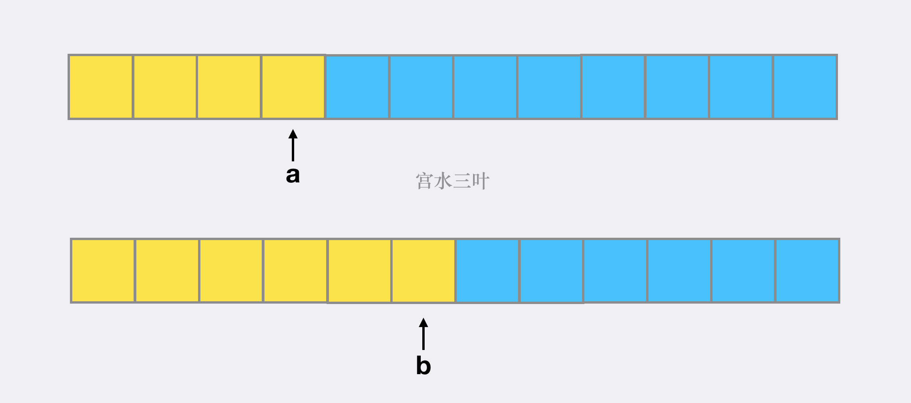
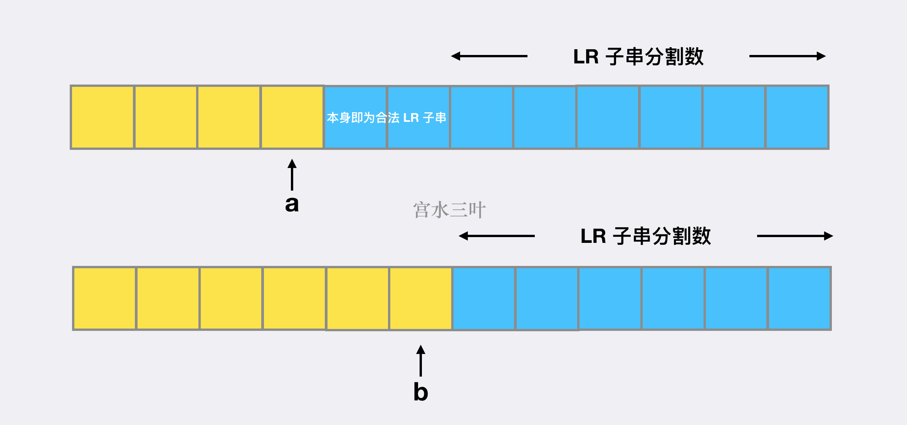

> 原文链接: https://leetcode-cn.com/problems/split-a-string-in-balanced-strings


## 英文原文
<div><p><strong>Balanced</strong> strings are those that have an equal quantity of <code>&#39;L&#39;</code> and <code>&#39;R&#39;</code> characters.</p>

<p>Given a <strong>balanced</strong> string <code>s</code>, split it in the maximum amount of balanced strings.</p>

<p>Return <em>the maximum amount of split <strong>balanced</strong> strings</em>.</p>

<p>&nbsp;</p>
<p><strong>Example 1:</strong></p>

<pre>
<strong>Input:</strong> s = &quot;RLRRLLRLRL&quot;
<strong>Output:</strong> 4
<strong>Explanation: </strong>s can be split into &quot;RL&quot;, &quot;RRLL&quot;, &quot;RL&quot;, &quot;RL&quot;, each substring contains same number of &#39;L&#39; and &#39;R&#39;.
</pre>

<p><strong>Example 2:</strong></p>

<pre>
<strong>Input:</strong> s = &quot;RLLLLRRRLR&quot;
<strong>Output:</strong> 3
<strong>Explanation: </strong>s can be split into &quot;RL&quot;, &quot;LLLRRR&quot;, &quot;LR&quot;, each substring contains same number of &#39;L&#39; and &#39;R&#39;.
</pre>

<p><strong>Example 3:</strong></p>

<pre>
<strong>Input:</strong> s = &quot;LLLLRRRR&quot;
<strong>Output:</strong> 1
<strong>Explanation: </strong>s can be split into &quot;LLLLRRRR&quot;.
</pre>

<p><strong>Example 4:</strong></p>

<pre>
<strong>Input:</strong> s = &quot;RLRRRLLRLL&quot;
<strong>Output:</strong> 2
<strong>Explanation: </strong>s can be split into &quot;RL&quot;, &quot;RRRLLRLL&quot;, since each substring contains an equal number of &#39;L&#39; and &#39;R&#39;
</pre>

<p>&nbsp;</p>
<p><strong>Constraints:</strong></p>

<ul>
	<li><code>1 &lt;= s.length &lt;= 1000</code></li>
	<li><code>s[i]</code> is either <code>&#39;L&#39;</code> or <code>&#39;R&#39;</code>.</li>
	<li><code>s</code> is a <strong>balanced</strong> string.</li>
</ul>
</div>

## 中文题目
<div><p>在一个 <strong>平衡字符串</strong> 中，<code>'L'</code> 和 <code>'R'</code> 字符的数量是相同的。</p>

<p>给你一个平衡字符串&nbsp;<code>s</code>，请你将它分割成尽可能多的平衡字符串。</p>

<p><strong>注意：</strong>分割得到的每个字符串都必须是平衡字符串，且分割得到的平衡字符串是原平衡字符串的连续子串。</p>

<p>返回可以通过分割得到的平衡字符串的 <strong>最大数量</strong> <strong>。</strong></p>

<p>&nbsp;</p>

<p><strong>示例 1：</strong></p>

<pre>
<strong>输入：</strong>s = "RLRRLLRLRL"
<strong>输出：</strong>4
<strong>解释：</strong>s 可以分割为 "RL"、"RRLL"、"RL"、"RL" ，每个子字符串中都包含相同数量的 'L' 和 'R' 。
</pre>

<p><strong>示例 2：</strong></p>

<pre>
<strong>输入：</strong>s = "RLLLLRRRLR"
<strong>输出：</strong>3
<strong>解释：</strong>s 可以分割为 "RL"、"LLLRRR"、"LR" ，每个子字符串中都包含相同数量的 'L' 和 'R' 。
</pre>

<p><strong>示例 3：</strong></p>

<pre>
<strong>输入：</strong>s = "LLLLRRRR"
<strong>输出：</strong>1
<strong>解释：</strong>s 只能保持原样 "LLLLRRRR".
</pre>

<p><strong>示例 4：</strong></p>

<pre>
<strong>输入：</strong>s = "RLRRRLLRLL"
<strong>输出：</strong>2
<strong>解释：</strong>s 可以分割为 "RL"、"RRRLLRLL" ，每个子字符串中都包含相同数量的 'L' 和 'R' 。
</pre>

<p>&nbsp;</p>

<p><strong>提示：</strong></p>

<ul>
	<li><code>1 &lt;= s.length &lt;= 1000</code></li>
	<li><code>s[i] = 'L' 或 'R'</code></li>
	<li><code>s</code> 是一个 <strong>平衡</strong> 字符串</li>
</ul>
</div>

## 通过代码
<RecoDemo>
</RecoDemo>


## 高赞题解
## 基本分析

题目确保了 `s` 为一个平衡字符串，即可以分割成若干个 `LR` 子串。

一个合法的 `LR` 子串满足 `L` 字符和 `R` 字符数量相等，常规检查一个字符串是否为合格的 `LR` 子串可以使用 $O(n)$ 的遍历方式，可以使用记录前缀信息的数据结构，而对于成对结构的元素统计，更好的方式是转换为数学判定，使用 `1` 来代指 `L` 得分，使用 `-1` 来代指 `R` 得分。

那么一个子串为合格 `LR` 子串的充要条件为 **整个 `LR` 子串的总得分为 $0$**。

这种方式最早应该在 [(题解) 301. 删除无效的括号](https://leetcode-cn.com/problems/remove-invalid-parentheses/solution/yi-fen-zhong-nei-kan-dong-jiang-gua-hao-aya6k/) 详细讲过，可延伸到任意的成对结构元素统计题目里去。

---

## 贪心

回到本题，题目要求分割的 `LR` 子串尽可能多，直观上应该是尽可能让每个分割串尽可能短。

**我们使用「归纳法」来证明该猜想的正确性。**

首先题目数据保证给定的 `s` 本身是合法的 `LR` 子串，假设从 $[0...a]$ 可以从 `s` 中分割出 **长度最小** 的 `LR` 子串，而从 $[0...b]$ 能够分割出 **长度更大** 的 `LR` 子串（即 `a <= b` )。



**我们来证明起始时（第一次分割）将「从 `b` 分割点将 `s` 断开」调整为「从 `a` 分割点将 `s` 断开」结果不会变差：**

1. 从 `b` 点首次分割调整为从 `a` 点首次分割，两种分割形式分割点两端仍为合法 `LR` 子串，因此不会从“有解”变成“无解”；

2. 从 `b` 分割后的剩余部分长度小于从 `a` 分割后的剩余部分，同时由 `b` 分割后的剩余部分会被由 `a` 分割后的剩余部分所严格覆盖，因此「对 `a` 分割的剩余部分再分割所得的子串数量」**至少** 与「从 `b` 点分割的剩余部分再分割所得的子串数量」相等（不会变少）。



**至此，我们证明了对于首次分割，将任意合格分割点调整为最小分割点，结果不会变得更差（当 `a < b` 时还会更好）。**

**同时，由于首次分割后的剩余部分仍为合格的 `LR` 子串，因此归纳分析所依赖的结构没有发生改变，可以将上述的推理分析推广到每一个决策的回合（新边界）中。**

**至此，我们证明了只要每一次都从最小分割点进行分割，就可以得到最优解。**


代码：
```Java []
class Solution {
    public int balancedStringSplit(String s) {
        char[] cs = s.toCharArray();
        int n = cs.length;
        int ans = 0;
        for (int i = 0; i < n; ) {
            int j = i + 1, score = cs[i] == 'L' ? 1 : -1;
            while (j < n && score != 0) score += cs[j++] == 'L' ? 1 : -1;
            i = j;
            ans++;
        }
        return ans;
    }
}
```
* 时间复杂度：$O(n)$
* 空间复杂度：调用 `toCharArray` 会拷贝新数组进行返回（为遵循 `String` 的不可变原则），因此使用 `toCharArray` 复杂度为 $O(n)$，使用 `charAt` 复杂度为 $O(1)$

---

## 其他「相信科学系列（贪心）」相关内容

不然发现，「贪心题」虽然大多数代码简单，但难度通常为「中等 / 困难」。

因为「贪心题」重点在于证明（特别在面试环节），只 AC 不证明的最大弊端在于：简单的条件修改后，选手根本无法回答原做法是否还是正确。

**因此「AC 并证明」才是正确的、科学的做「贪心题」的态度，而不是因为「不会证明 / 看不懂证明」而选择放弃证明，甚至对证明嗤之以鼻。**

对于贪心题证明，大多数人可能会经历如下几个阶段：

「没意识到需要证明」->「意识到需要证明，但不会并看不懂证明」->「看得懂证明，但是证明不出来」->「能自己给出证明」

其中第一步到第二步的距离，比最后两步距离加起来还要远。

**我猜这才是大多数人不谈「证明」的理由（ta 没走出第一步），而非「证明」不重要。**

| 题目                                                         | 题解                                                         | 难度 | 推荐指数 |
| ------------------------------------------------------------ | ------------------------------------------------------------ | ---- | -------- |
| [11. 盛最多水的容器 ](https://leetcode-cn.com/problems/container-with-most-water/) | [LeetCode 题解链接](https://leetcode-cn.com/problems/container-with-most-water/solution/shua-chuan-lc-shuang-zhi-zhen-tan-xin-ji-52gf/) | 中等 | 🤩🤩🤩🤩🤩    |
| [45. 跳跃游戏 II](https://leetcode-cn.com/problems/jump-game-ii/) | [LeetCode 题解链接](https://leetcode-cn.com/problems/jump-game-ii/solution/xiang-jie-dp-tan-xin-shuang-zhi-zhen-jie-roh4/) | 中等 | 🤩🤩🤩🤩     |
| [179. 最大数](https://leetcode-cn.com/problems/largest-number/) | [LeetCode 题解链接](https://leetcode-cn.com/problems/largest-number/solution/gong-shui-san-xie-noxiang-xin-ke-xue-xi-vn86e/) | 中等 | 🤩🤩🤩🤩     |
| [561. 数组拆分 I](https://leetcode-cn.com/problems/array-partition-i/) | [LeetCode 题解链接](https://leetcode-cn.com/problems/array-partition-i/solution/jue-dui-neng-kan-dong-de-zheng-ming-fan-f7trz/) | 简单 | 🤩🤩🤩🤩     |
| [765. 情侣牵手](https://leetcode-cn.com/problems/couples-holding-hands/) | [LeetCode 题解链接](https://leetcode-cn.com/problems/couples-holding-hands/solution/liang-chong-100-de-jie-fa-bing-cha-ji-ta-26a6/) | 困难 | 🤩🤩🤩      |
| [781. 森林中的兔子](https://leetcode-cn.com/problems/rabbits-in-forest/) | [LeetCode 题解链接](https://leetcode-cn.com/problems/rabbits-in-forest/solution/gong-shui-san-xie-noxiang-xin-ke-xue-xi-v17p5/) | 中等 | 🤩🤩🤩🤩     |
| [881. 救生艇](https://leetcode-cn.com/problems/boats-to-save-people/) | [LeetCode 题解链接](https://leetcode-cn.com/problems/boats-to-save-people/solution/gong-shui-san-xie-noxiang-xin-ke-xue-xi-hosg8/) | 中等 | 🤩🤩🤩🤩     |
| [995. K 连续位的最小翻转次数](https://leetcode-cn.com/problems/minimum-number-of-k-consecutive-bit-flips/) | [LeetCode 题解链接](https://leetcode-cn.com/problems/minimum-number-of-k-consecutive-bit-flips/solution/po-su-tan-xin-jie-fa-yu-tan-xin-chai-fen-4lyy/) | 困难 | 🤩🤩🤩      |
| [1221. 分割平衡字符串](https://leetcode-cn.com/problems/split-a-string-in-balanced-strings/) | [LeetCode 题解链接](https://leetcode-cn.com/problems/split-a-string-in-balanced-strings/solution/gong-shui-san-xie-noxiang-xin-ke-xue-xi-wumnk/) | 简单 | 🤩🤩🤩🤩     |
| [1707. 与数组中元素的最大异或值](https://leetcode-cn.com/problems/maximum-xor-with-an-element-from-array/) | [LeetCode 题解链接](https://leetcode-cn.com/problems/maximum-xor-with-an-element-from-array/solution/gong-shui-san-xie-jie-zhe-ge-wen-ti-lai-lypqr/) | 困难 | 🤩🤩🤩      |
| [1713. 得到子序列的最少操作次数](https://leetcode-cn.com/problems/minimum-operations-to-make-a-subsequence/) | [LeetCode 题解链接](https://leetcode-cn.com/problems/minimum-operations-to-make-a-subsequence/solution/gong-shui-san-xie-noxiang-xin-ke-xue-xi-oj7yu/) | 困难 | 🤩🤩🤩🤩🤩    |
| [1833. 雪糕的最大数量](https://leetcode-cn.com/problems/maximum-ice-cream-bars/) | [LeetCode 题解链接](https://leetcode-cn.com/problems/maximum-ice-cream-bars/solution/gong-shui-san-xie-noxiang-xin-ke-xue-xi-yrhjx/) | 中等 | 🤩🤩🤩🤩🤩    |
| [1846. 减小和重新排列数组后的最大元素](https://leetcode-cn.com/problems/maximum-element-after-decreasing-and-rearranging/) | [LeetCode 题解链接](https://leetcode-cn.com/problems/maximum-element-after-decreasing-and-rearranging/solution/gong-shui-san-xie-noxiang-xin-ke-xue-xi-yh9qt/) | 中等 | 🤩🤩🤩🤩🤩    |
| [1877. 数组中最大数对和的最小值](https://leetcode-cn.com/problems/minimize-maximum-pair-sum-in-array/) | [LeetCode 题解链接](https://leetcode-cn.com/problems/minimize-maximum-pair-sum-in-array/solution/gong-shui-san-xie-noxiang-xin-ke-xue-xi-ru29y/) | 中等 | 🤩🤩🤩🤩🤩    |

**注：以上目录整理来自 [wiki](https://github.com/SharingSource/LogicStack-LeetCode/wiki/贪心算法)，任何形式的转载引用请保留出处。**

---

## 最后

**如果有帮助到你，请给题解点个赞和收藏，让更多的人看到 ~ ("▔□▔)/**


## 统计信息
| 通过次数 | 提交次数 | AC比率 |
| :------: | :------: | :------: |
|    77974    |    92391    |   84.4%   |

## 提交历史
| 提交时间 | 提交结果 | 执行时间 |  内存消耗  | 语言 |
| :------: | :------: | :------: | :--------: | :--------: |
