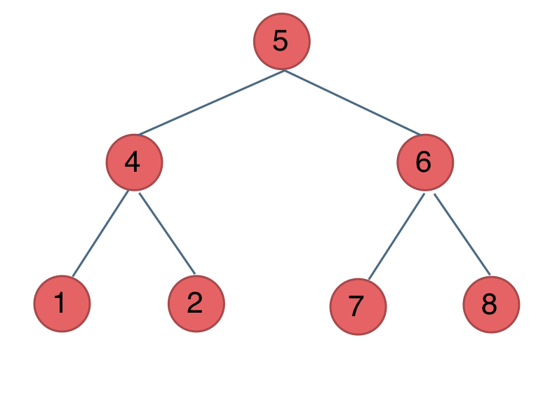
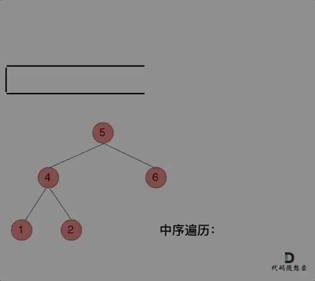
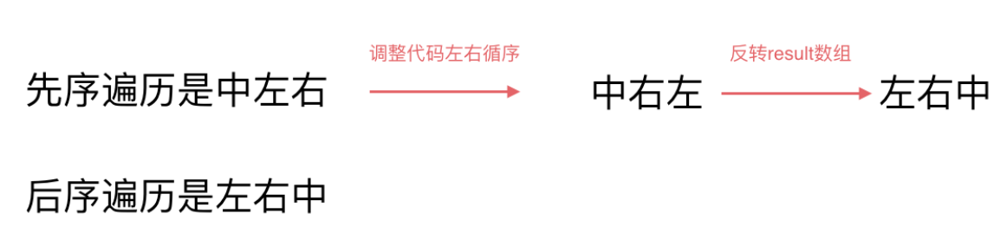
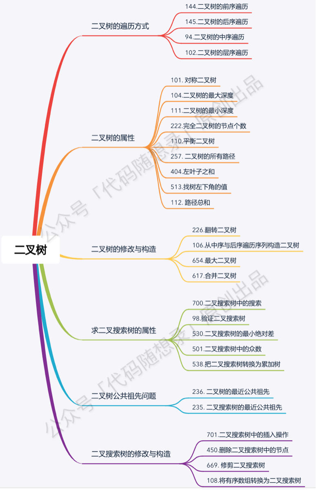

> 原文链接: https://leetcode-cn.com/problems/binary-tree-postorder-traversal


## 英文原文
<div><p>Given the <code>root</code> of a&nbsp;binary tree, return <em>the postorder traversal of its nodes&#39; values</em>.</p>

<p>&nbsp;</p>
<p><strong>Example 1:</strong></p>

<pre>
<strong>Input:</strong> root = [1,null,2,3]
<strong>Output:</strong> [3,2,1]
</pre>

<p><strong>Example 2:</strong></p>

<pre>
<strong>Input:</strong> root = []
<strong>Output:</strong> []
</pre>

<p><strong>Example 3:</strong></p>

<pre>
<strong>Input:</strong> root = [1]
<strong>Output:</strong> [1]
</pre>

<p><strong>Example 4:</strong></p>

<pre>
<strong>Input:</strong> root = [1,2]
<strong>Output:</strong> [2,1]
</pre>

<p><strong>Example 5:</strong></p>

<pre>
<strong>Input:</strong> root = [1,null,2]
<strong>Output:</strong> [2,1]
</pre>

<p>&nbsp;</p>
<p><strong>Constraints:</strong></p>

<ul>
	<li>The number of the nodes in the tree is in the range <code>[0, 100]</code>.</li>
	<li><code>-100 &lt;= Node.val &lt;= 100</code></li>
</ul>

<p>&nbsp;</p>
<strong>Follow up:</strong> Recursive solution is trivial, could you do it iteratively?</div>

## 中文题目
<div><p>给定一个二叉树，返回它的 <em>后序&nbsp;</em>遍历。</p>

<p><strong>示例:</strong></p>

<pre><strong>输入:</strong> [1,null,2,3]  
   1
    \
     2
    /
   3 

<strong>输出:</strong> [3,2,1]</pre>

<p><strong>进阶:</strong>&nbsp;递归算法很简单，你可以通过迭代算法完成吗？</p>
</div>

## 通过代码
<RecoDemo>
</RecoDemo>


## 高赞题解
**不少同学对二叉树的递归与非递归遍历，前中后序都还处于朦胧状态，我特意录了一期视频，讲一讲[二叉树的遍历](https://www.bilibili.com/video/BV1Wh411S7xt)**，还详细介绍了我们做二叉树的时候常遇到的问题，相信结合本篇题解，会对你学习二叉树有所帮助。


这篇文章，**彻底讲清楚应该如何写递归，并给出了前中后序三种不同的迭代法，然后分析迭代法的代码风格为什么没有统一，最后给出统一的前中后序迭代法的代码，帮大家彻底吃透二叉树的深度优先遍历。**


以下开始开始正文：

* 二叉树深度优先遍历
    * 前序遍历： 144.二叉树的前序遍历
    * 后序遍历： 145.二叉树的后序遍历
    * 中序遍历： 94.二叉树的中序遍历
* 二叉树广度优先遍历 
    * 层序遍历：102.二叉树的层序遍历


先帮大家明确一下二叉树的遍历规则：




以上述中，前中后序遍历顺序如下：

* 前序遍历（中左右）：5 4 1 2 6 7 8
* 中序遍历（左中右）：1 4 2 5 7 6 8
* 后序遍历（左右中）：1 2 4 7 8 6 5

# 递归法

这次我们要好好谈一谈递归，为什么很多同学看递归算法都是“一看就会，一写就废”。

主要是对递归不成体系，没有方法论，**每次写递归算法 ，都是靠玄学来写代码**，代码能不能编过都靠运气。

**本篇将介绍前后中序的递归写法，一些同学可能会感觉很简单，其实不然，我们要通过简单题目把方法论确定下来，有了方法论，后面才能应付复杂的递归。**

这里帮助大家确定下来递归算法的三个要素。**每次写递归，都按照这三要素来写，可以保证大家写出正确的递归算法！**

1. **确定递归函数的参数和返回值：**
确定哪些参数是递归的过程中需要处理的，那么就在递归函数里加上这个参数， 并且还要明确每次递归的返回值是什么进而确定递归函数的返回类型。

2. **确定终止条件：**
写完了递归算法,  运行的时候，经常会遇到栈溢出的错误，就是没写终止条件或者终止条件写的不对，操作系统也是用一个栈的结构来保存每一层递归的信息，如果递归没有终止，操作系统的内存栈必然就会溢出。

3. **确定单层递归的逻辑：**
确定每一层递归需要处理的信息。在这里也就会重复调用自己来实现递归的过程。

好了，我们确认了递归的三要素，接下来就来练练手：

**以下以前序遍历为例：**

1. **确定递归函数的参数和返回值**：因为要打印出前序遍历节点的数值，所以参数里需要传入vector在放节点的数值，除了这一点就不需要在处理什么数据了也不需要有返回值，所以递归函数返回类型就是void，代码如下：

```
void traversal(TreeNode* cur, vector<int>& vec)
```

2. **确定终止条件**：在递归的过程中，如何算是递归结束了呢，当然是当前遍历的节点是空了，那么本层递归就要要结束了，所以如果当前遍历的这个节点是空，就直接return，代码如下：

```
if (cur == NULL) return;
```

3. **确定单层递归的逻辑**：前序遍历是中左右的循序，所以在单层递归的逻辑，是要先取中节点的数值，代码如下：

```
vec.push_back(cur->val);    // 中
traversal(cur->left, vec);  // 左
traversal(cur->right, vec); // 右
```

单层递归的逻辑就是按照中左右的顺序来处理的，这样二叉树的前序遍历，基本就写完了，在看一下完整代码：

前序遍历：

```
class Solution {
public:
    void traversal(TreeNode* cur, vector<int>& vec) {
        if (cur == NULL) return;
        vec.push_back(cur->val);    // 中
        traversal(cur->left, vec);  // 左
        traversal(cur->right, vec); // 右
    }
    vector<int> preorderTraversal(TreeNode* root) {
        vector<int> result;
        traversal(root, result);
        return result;
    }
};
```

那么前序遍历写出来之后，中序和后序遍历就不难理解了，代码如下：

中序遍历：

```
    void traversal(TreeNode* cur, vector<int>& vec) {
        if (cur == NULL) return;
        traversal(cur->left, vec);  // 左
        vec.push_back(cur->val);    // 中
        traversal(cur->right, vec); // 右
    }
```

后序遍历：

```
    void traversal(TreeNode* cur, vector<int>& vec) {
        if (cur == NULL) return;
        traversal(cur->left, vec);  // 左
        traversal(cur->right, vec); // 右
        vec.push_back(cur->val);    // 中
    }
```

此时大家可以做一做leetcode上三道题目，分别是：

* 144.二叉树的前序遍历
* 145.二叉树的后序遍历
* 94.二叉树的中序遍历

可能有同学感觉前后中序遍历的递归太简单了，要打迭代法（非递归），别急，我们明天打迭代法，打个通透！


# 迭代法 

为什么可以用迭代法（非递归的方式）来实现二叉树的前后中序遍历呢？

**递归的实现就是：每一次递归调用都会把函数的局部变量、参数值和返回地址等压入调用栈中**，然后递归返回的时候，从栈顶弹出上一次递归的各项参数，所以这就是递归为什么可以返回上一层位置的原因。

此时大家应该知道我们用栈也可以是实现二叉树的前后中序遍历了。

## 前序遍历（迭代法）

我们先看一下前序遍历。

前序遍历是中左右，每次先处理的是中间节点，那么先将跟节点放入栈中，然后将右孩子加入栈，再加入左孩子。

为什么要先加入 右孩子，再加入左孩子呢？ 因为这样出栈的时候才是中左右的顺序。

动画如下：


不难写出如下代码: （**注意代码中空节点不入栈**）

```
class Solution {
public:
    vector<int> preorderTraversal(TreeNode* root) {
        stack<TreeNode*> st;
        vector<int> result;
        if (root == NULL) return result;
        st.push(root);
        while (!st.empty()) {
            TreeNode* node = st.top();                       // 中
            st.pop();
            result.push_back(node->val);
            if (node->right) st.push(node->right);           // 右（空节点不入栈）
            if (node->left) st.push(node->left);             // 左（空节点不入栈）
        }
        return result;
    }
};
```

此时会发现貌似使用迭代法写出前序遍历并不难，确实不难。

**此时是不是想改一点前序遍历代码顺序就把中序遍历搞出来了？**

其实还真不行！

但接下来，**再用迭代法写中序遍历的时候，会发现套路又不一样了，目前的前序遍历的逻辑无法直接应用到中序遍历上。**

## 中序遍历（迭代法）

为了解释清楚，我说明一下 刚刚在迭代的过程中，其实我们有两个操作：

1. **处理：将元素放进result数组中**
2. **访问：遍历节点**

分析一下为什么刚刚写的前序遍历的代码，不能和中序遍历通用呢，因为前序遍历的顺序是中左右，先访问的元素是中间节点，要处理的元素也是中间节点，所以刚刚才能写出相对简洁的代码，**因为要访问的元素和要处理的元素顺序是一致的，都是中间节点。**

那么再看看中序遍历，中序遍历是左中右，先访问的是二叉树顶部的节点，然后一层一层向下访问，直到到达树左面的最底部，再开始处理节点（也就是在把节点的数值放进result数组中），这就造成了**处理顺序和访问顺序是不一致的。**

那么**在使用迭代法写中序遍历，就需要借用指针的遍历来帮助访问节点，栈则用来处理节点上的元素。**

动画如下：



**中序遍历，可以写出如下代码：**

```
class Solution {
public:
    vector<int> inorderTraversal(TreeNode* root) {
        vector<int> result;
        stack<TreeNode*> st;
        TreeNode* cur = root;
        while (cur != NULL || !st.empty()) {
            if (cur != NULL) { // 指针来访问节点，访问到最底层
                st.push(cur); // 将访问的节点放进栈
                cur = cur->left;                // 左
            } else {
                cur = st.top(); // 从栈里弹出的数据，就是要处理的数据（放进result数组里的数据）
                st.pop();
                result.push_back(cur->val);     // 中
                cur = cur->right;               // 右
            }
        }
        return result;
    }
};

```

## 后序遍历（迭代法）

再来看后序遍历，先序遍历是中左右，后续遍历是左右中，那么我们只需要调整一下先序遍历的代码顺序，就变成中右左的遍历顺序，然后在反转result数组，输出的结果顺序就是左右中了，如下图：



**所以后序遍历只需要前序遍历的代码稍作修改就可以了，代码如下：**

```C++
class Solution {
public:
    vector<int> postorderTraversal(TreeNode* root) {
        stack<TreeNode*> st;
        vector<int> result;
        if (root == NULL) return result;
        st.push(root);
        while (!st.empty()) {
            TreeNode* node = st.top();
            st.pop();
            result.push_back(node->val);
            if (node->left) st.push(node->left); // 相对于前序遍历，这更改一下入栈顺序 （空节点不入栈）
            if (node->right) st.push(node->right); // 空节点不入栈
        }
        reverse(result.begin(), result.end()); // 将结果反转之后就是左右中的顺序了
        return result;
    }
};

```


此时我们实现了前后中遍历的三种迭代法，**是不是发现迭代法实现的先中后序，其实风格也不是那么统一，除了先序和后序，有关联，中序完全就是另一个风格了，一会用栈遍历，一会又用指针来遍历。**

# 二叉树前中后迭代方式统一写法

**迭代法实现的先中后序，其实风格也不是那么统一，除了先序和后序，有关联，中序完全就是另一个风格了，一会用栈遍历，一会又用指针来遍历。**

实践过的同学，也会发现使用迭代法实现先中后序遍历，很难写出统一的代码，不像是递归法，实现了其中的一种遍历方式，其他两种只要稍稍改一下节点顺序就可以了。

其实**针对三种遍历方式，使用迭代法是可以写出统一风格的代码！**

**重头戏来了，接下来介绍一下统一写法。**

我们以中序遍历为例，**无法同时解决访问节点（遍历节点）和处理节点（将元素放进结果集）不一致的情况**。

**那我们就将访问的节点放入栈中，把要处理的节点也放入栈中但是要做标记。**

如何标记呢，**就是要处理的节点放入栈之后，紧接着放入一个空指针作为标记。** 这种方法也可以叫做标记法。

## 迭代法中序遍历

中序遍历代码如下：（详细注释）

```C++
class Solution {
public:
    vector<int> inorderTraversal(TreeNode* root) {
        vector<int> result;
        stack<TreeNode*> st;
        if (root != NULL) st.push(root);
        while (!st.empty()) {
            TreeNode* node = st.top();
            if (node != NULL) {
                st.pop(); // 将该节点弹出，避免重复操作，下面再将右中左节点添加到栈中
                if (node->right) st.push(node->right);  // 添加右节点（空节点不入栈）

                st.push(node);                          // 添加中节点
                st.push(NULL); // 中节点访问过，但是还没有处理，加入空节点做为标记。

                if (node->left) st.push(node->left);    // 添加左节点（空节点不入栈）
            } else { // 只有遇到空节点的时候，才将下一个节点放进结果集
                st.pop();           // 将空节点弹出
                node = st.top();    // 重新取出栈中元素
                st.pop();
                result.push_back(node->val); // 加入到结果集
            }
        }
        return result;
    }
};
```

看代码有点抽象我们来看一下动画(中序遍历)：


动画中，result数组就是最终结果集。

可以看出我们将访问的节点直接加入到栈中，但如果是处理的节点则后面放入一个空节点， 这样只有空节点弹出的时候，才将下一个节点放进结果集。

此时我们再来看前序遍历代码。


## 迭代法前序遍历

迭代法前序遍历代码如下： (**注意此时我们和中序遍历相比仅仅改变了两行代码的顺序**)

```C++
class Solution {
public:
    vector<int> preorderTraversal(TreeNode* root) {
        vector<int> result;
        stack<TreeNode*> st;
        if (root != NULL) st.push(root);
        while (!st.empty()) {
            TreeNode* node = st.top();
            if (node != NULL) {
                st.pop();
                if (node->right) st.push(node->right);  // 右
                if (node->left) st.push(node->left);    // 左
                st.push(node);                          // 中
                st.push(NULL);
            } else {
                st.pop();
                node = st.top();
                st.pop();
                result.push_back(node->val);
            }
        }
        return result;
    }
};
```

## 迭代法后序遍历

后续遍历代码如下： (**注意此时我们和中序遍历相比仅仅改变了两行代码的顺序**)

```C++
class Solution {
public:
    vector<int> postorderTraversal(TreeNode* root) {
        vector<int> result;
        stack<TreeNode*> st;
        if (root != NULL) st.push(root);
        while (!st.empty()) {
            TreeNode* node = st.top();
            if (node != NULL) {
                st.pop();
                st.push(node);                          // 中
                st.push(NULL);

                if (node->right) st.push(node->right);  // 右
                if (node->left) st.push(node->left);    // 左

            } else {
                st.pop();
                node = st.top();
                st.pop();
                result.push_back(node->val);
            }
        }
        return result;
    }
};
```

# 总结

此时我们写出了统一风格的迭代法，不用在纠结于前序写出来了，中序写不出来的情况了。

但是统一风格的迭代法并不好理解，而且想在面试直接写出来还有难度的。

所以大家根据自己的个人喜好，对于二叉树的前中后序遍历，选择一种自己容易理解的递归和迭代法。

## 其他语言版本（递归）


Java：
```Java
// 前序遍历·递归·LC144_二叉树的前序遍历
class Solution {
    ArrayList<Integer> preOrderReverse(TreeNode root) {
        ArrayList<Integer> result = new ArrayList<Integer>();
        preOrder(root, result);
        return result;
    }

    void preOrder(TreeNode root, ArrayList<Integer> result) {
        if (root == null) {
            return;
        }
        result.add(root.val);           // 注意这一句
        preOrder(root.left, result);
        preOrder(root.right, result);
    }
}
// 中序遍历·递归·LC94_二叉树的中序遍历
class Solution {
    public List<Integer> inorderTraversal(TreeNode root) {
        List<Integer> res = new ArrayList<>();
        inorder(root, res);
        return res;
    }

    void inorder(TreeNode root, List<Integer> list) {
        if (root == null) {
            return;
        }
        inorder(root.left, list);
        list.add(root.val);             // 注意这一句
        inorder(root.right, list);
    }
}
// 后序遍历·递归·LC145_二叉树的后序遍历
class Solution {
    public List<Integer> postorderTraversal(TreeNode root) {
        List<Integer> res = new ArrayList<>();
        postorder(root, res);
        return res;
    }

    void postorder(TreeNode root, List<Integer> list) {
        if (root == null) {
            return;
        }
        postorder(root.left, list);
        postorder(root.right, list);
        list.add(root.val);             // 注意这一句
    }
}
```

Python：
```python3
# 前序遍历-递归-LC144_二叉树的前序遍历
class Solution:
    def preorderTraversal(self, root: TreeNode) -> List[int]:
        # 保存结果
        result = []
        
        def traversal(root: TreeNode):
            if root == None:
                return
            result.append(root.val) # 前序
            traversal(root.left)    # 左
            traversal(root.right)   # 右

        traversal(root)
        return result

# 中序遍历-递归-LC94_二叉树的中序遍历
class Solution:
    def inorderTraversal(self, root: TreeNode) -> List[int]:
        result = []

        def traversal(root: TreeNode):
            if root == None:
                return
            traversal(root.left)    # 左
            result.append(root.val) # 中序
            traversal(root.right)   # 右

        traversal(root)
        return result

# 后序遍历-递归-LC145_二叉树的后序遍历
class Solution:
    def postorderTraversal(self, root: TreeNode) -> List[int]:
        result = []

        def traversal(root: TreeNode):
            if root == None:
                return
            traversal(root.left)    # 左
            traversal(root.right)   # 右
            result.append(root.val) # 后序

        traversal(root)
        return result
```

Go：

前序遍历:
```go
func PreorderTraversal(root *TreeNode) (res []int) {
    var traversal func(node *TreeNode)
    traversal = func(node *TreeNode) {
	if node == nil {
            return
	}
	res = append(res,node.Val)
	traversal(node.Left)
	traversal(node.Right)
    }
    traversal(root)
    return res
}

```
中序遍历:

```go
func InorderTraversal(root *TreeNode) (res []int) {
    var traversal func(node *TreeNode)
    traversal = func(node *TreeNode) {
	if node == nil {
	    return
	}
	traversal(node.Left)
	res = append(res,node.Val)
	traversal(node.Right)
    }
    traversal(root)
    return res
}
```
后序遍历:

```go
func PostorderTraversal(root *TreeNode) (res []int) {
    var traversal func(node *TreeNode)
    traversal = func(node *TreeNode) {
	if node == nil {
	    return
	}
	traversal(node.Left)
	traversal(node.Right)
        res = append(res,node.Val)
    }
    traversal(root)
    return res
}
```

javaScript:

```js

前序遍历:

var preorderTraversal = function(root, res = []) {
    if (!root) return res;
    res.push(root.val);
    preorderTraversal(root.left, res)
    preorderTraversal(root.right, res)
    return res;
};

中序遍历:

var inorderTraversal = function(root, res = []) {
    if (!root) return res;
    inorderTraversal(root.left, res);
    res.push(root.val);
    inorderTraversal(root.right, res);
    return res;
};

后序遍历:

var postorderTraversal = function(root, res = []) {
    if (!root) return res;
    postorderTraversal(root.left, res);
    postorderTraversal(root.right, res);
    res.push(root.val);
    return res;
};
```
Javascript版本：

前序遍历：
```Javascript
var preorderTraversal = function(root) {
 let res=[];
 const dfs=function(root){
     if(root===null)return ;
     //先序遍历所以从父节点开始
     res.push(root.val);
     //递归左子树
     dfs(root.left);
     //递归右子树
     dfs(root.right);
 }
 //只使用一个参数 使用闭包进行存储结果
 dfs(root);
 return res;
};
```
中序遍历
```javascript
var inorderTraversal = function(root) {
    let res=[];
    const dfs=function(root){
        if(root===null){
            return ;
        }
        dfs(root.left);
        res.push(root.val);
        dfs(root.right);
    }
    dfs(root);
    return res;
};
```

后序遍历
```javascript
var postorderTraversal = function(root) {
    let res=[];
    const dfs=function(root){
        if(root===null){
            return ;
        }
        dfs(root.left);
        dfs(root.right);
        res.push(root.val);
    }
    dfs(root);
    return res;
};
```

## 其他语言版本（迭代不统一写法）

Java：

```java
// 前序遍历顺序：中-左-右，入栈顺序：中-右-左
class Solution {
    public List<Integer> preorderTraversal(TreeNode root) {
        List<Integer> result = new ArrayList<>();
        if (root == null){
            return result;
        }
        Stack<TreeNode> stack = new Stack<>();
        stack.push(root);
        while (!stack.isEmpty()){
            TreeNode node = stack.pop();
            result.add(node.val);
            if (node.right != null){
                stack.push(node.right);
            }
            if (node.left != null){
                stack.push(node.left);
            }
        }
        return result;
    }
}

// 中序遍历顺序: 左-中-右 入栈顺序： 左-右
class Solution {
    public List<Integer> inorderTraversal(TreeNode root) {
        List<Integer> result = new ArrayList<>();
        if (root == null){
            return result;
        }
        Stack<TreeNode> stack = new Stack<>();
        TreeNode cur = root;
        while (cur != null || !stack.isEmpty()){
           if (cur != null){
               stack.push(cur);
               cur = cur.left;
           }else{
               cur = stack.pop();
               result.add(cur.val);
               cur = cur.right;
           }
        }
        return result;
    }
}

// 后序遍历顺序 左-右-中 入栈顺序：中-左-右 出栈顺序：中-右-左， 最后翻转结果
class Solution {
    public List<Integer> postorderTraversal(TreeNode root) {
        List<Integer> result = new ArrayList<>();
        if (root == null){
            return result;
        }
        Stack<TreeNode> stack = new Stack<>();
        stack.push(root);
        while (!stack.isEmpty()){
            TreeNode node = stack.pop();
            result.add(node.val);
            if (node.left != null){
                stack.push(node.left);
            }
            if (node.right != null){
                stack.push(node.right);
            }
        }
        Collections.reverse(result);
        return result;
    }
}
```


Python：
```python3
# 前序遍历-迭代-LC144_二叉树的前序遍历
class Solution:
    def preorderTraversal(self, root: TreeNode) -> List[int]:
        # 根结点为空则返回空列表
        if not root:
            return []
        stack = [root]
        result = []
        while stack:
            node = stack.pop()
            # 中结点先处理
            result.append(node.val)
            # 右孩子先入栈
            if node.right:
                stack.append(node.right)
            # 左孩子后入栈
            if node.left:
                stack.append(node.left)
        return result
        
# 中序遍历-迭代-LC94_二叉树的中序遍历
class Solution:
    def inorderTraversal(self, root: TreeNode) -> List[int]:
        if not root:
            return []
        stack = []  # 不能提前将root结点加入stack中
        result = []
        cur = root
        while cur or stack:
            # 先迭代访问最底层的左子树结点
            if cur:     
                stack.append(cur)
                cur = cur.left		
            # 到达最左结点后处理栈顶结点    
            else:		
                cur = stack.pop()
                result.append(cur.val)
                # 取栈顶元素右结点
                cur = cur.right	
        return result
        
# 后序遍历-迭代-LC145_二叉树的后序遍历
class Solution:
    def postorderTraversal(self, root: TreeNode) -> List[int]:
        if not root:
            return []
        stack = [root]
        result = []
        while stack:
            node = stack.pop()
            # 中结点先处理
            result.append(node.val)
            # 左孩子先入栈
            if node.left:
                stack.append(node.left)
            # 右孩子后入栈
            if node.right:
                stack.append(node.right)
        # 将最终的数组翻转
        return result[::-1]
```


Go：
> 迭代法前序遍历

```go
//迭代法前序遍历
/**
 type Element struct {
    // 元素保管的值
    Value interface{}
    // 内含隐藏或非导出字段
}

func (l *List) Back() *Element 
前序遍历：中左右
压栈顺序：右左中
 **/
func preorderTraversal(root *TreeNode) []int {
	if root == nil {
		return nil
	}
	var stack = list.New()
    stack.PushBack(root.Right)
    stack.PushBack(root.Left)
    res:=[]int{}
    res=append(res,root.Val)
    for stack.Len()>0 {
        e:=stack.Back()
        stack.Remove(e)
        node := e.Value.(*TreeNode)//e是Element类型，其值为e.Value.由于Value为接口，所以要断言
        if node==nil{
            continue
        }
        res=append(res,node.Val)
        stack.PushBack(node.Right)
        stack.PushBack(node.Left)
    }
    return res
}
```

> 迭代法后序遍历

```go
//迭代法后序遍历
//后续遍历：左右中
//压栈顺序：中右左(按照前序遍历思路)，再反转结果数组
func postorderTraversal(root *TreeNode) []int {
	if root == nil {
		return nil
	}
	var stack = list.New()
    stack.PushBack(root.Left)
    stack.PushBack(root.Right)
    res:=[]int{}
    res=append(res,root.Val)
    for stack.Len()>0 {
        e:=stack.Back()
        stack.Remove(e)
        node := e.Value.(*TreeNode)//e是Element类型，其值为e.Value.由于Value为接口，所以要断言
        if node==nil{
            continue
        }
        res=append(res,node.Val)
        stack.PushBack(node.Left)
        stack.PushBack(node.Right)
    }
    for i:=0;i<len(res)/2;i++{
        res[i],res[len(res)-i-1] = res[len(res)-i-1],res[i]
    }
    return res
}
```

> 迭代法中序遍历

```go
//迭代法中序遍历
func inorderTraversal(root *TreeNode) []int {
    rootRes:=[]int{}
    if root==nil{
       return nil
    }
    stack:=list.New()
    node:=root
    //先将所有左节点找到，加入栈中
    for node!=nil{
        stack.PushBack(node)
        node=node.Left
    }
    //其次对栈中的每个节点先弹出加入到结果集中，再找到该节点的右节点的所有左节点加入栈中
    for stack.Len()>0{
        e:=stack.Back()
        node:=e.Value.(*TreeNode)
        stack.Remove(e)
        //找到该节点的右节点，再搜索他的所有左节点加入栈中
        rootRes=append(rootRes,node.Val)
        node=node.Right
        for node!=nil{
            stack.PushBack(node)
            node=node.Left
        }
    }
    return rootRes
}
```

javaScript

```js

前序遍历:

// 入栈 右 -> 左
// 出栈 中 -> 左 -> 右
var preorderTraversal = function(root, res = []) {
    if(!root) return res;
    const stack = [root];
    let cur = null;
    while(stack.length) {
        cur = stack.pop();
        res.push(cur.val);
        cur.right && stack.push(cur.right);
        cur.left && stack.push(cur.left);
    }
    return res;
};

中序遍历:

// 入栈 左 -> 右
// 出栈 左 -> 中 -> 右

var inorderTraversal = function(root, res = []) {
    const stack = [];
    let cur = root;
    while(stack.length || cur) {
        if(cur) {
            stack.push(cur);
            // 左
            cur = cur.left;
        } else {
            // --> 弹出 中
            cur = stack.pop();
            res.push(cur.val); 
            // 右
            cur = cur.right;
        }
    };
    return res;
};

后序遍历:

// 入栈 左 -> 右
// 出栈 中 -> 右 -> 左 结果翻转

var postorderTraversal = function(root, res = []) {
    if (!root) return res;
    const stack = [root];
    let cur = null;
    do {
        cur = stack.pop();
        res.push(cur.val);
        cur.left && stack.push(cur.left);
        cur.right && stack.push(cur.right);
    } while(stack.length);
    return res.reverse();
};
```

## 其他语言版本（迭代统一写法）


Java：
  迭代法前序遍历代码如下:
  ```java
  class Solution {
    
    public List<Integer> preorderTraversal(TreeNode root) {
        List<Integer> result = new LinkedList<>();
        Stack<TreeNode> st = new Stack<>();
        if (root != null) st.push(root);
        while (!st.empty()) {
            TreeNode node = st.peek();
            if (node != null) {
                st.pop(); // 将该节点弹出，避免重复操作，下面再将右中左节点添加到栈中
                if (node.right!=null) st.push(node.right);  // 添加右节点（空节点不入栈）
                if (node.left!=null) st.push(node.left);    // 添加左节点（空节点不入栈）
                st.push(node);                          // 添加中节点
                st.push(null); // 中节点访问过，但是还没有处理，加入空节点做为标记。
                
            } else { // 只有遇到空节点的时候，才将下一个节点放进结果集
                st.pop();           // 将空节点弹出
                node = st.peek();    // 重新取出栈中元素
                st.pop();
                result.add(node.val); // 加入到结果集
            }
        }
        return result;
    }
}

  ```
  迭代法中序遍历代码如下:
  ```java
  class Solution {
    public List<Integer> inorderTraversal(TreeNode root) {
		    List<Integer> result = new LinkedList<>();
        Stack<TreeNode> st = new Stack<>();
        if (root != null) st.push(root);
        while (!st.empty()) {
            TreeNode node = st.peek();
            if (node != null) {
                st.pop(); // 将该节点弹出，避免重复操作，下面再将右中左节点添加到栈中
                if (node.right!=null) st.push(node.right);  // 添加右节点（空节点不入栈）
                st.push(node);                          // 添加中节点
                st.push(null); // 中节点访问过，但是还没有处理，加入空节点做为标记。

                if (node.left!=null) st.push(node.left);    // 添加左节点（空节点不入栈）
            } else { // 只有遇到空节点的时候，才将下一个节点放进结果集
                st.pop();           // 将空节点弹出
                node = st.peek();    // 重新取出栈中元素
                st.pop();
                result.add(node.val); // 加入到结果集
            }
        }
        return result;
    }
}
  ```
  迭代法后序遍历代码如下:
  ```java
  class Solution {

   public List<Integer> postorderTraversal(TreeNode root) {
        List<Integer> result = new LinkedList<>();
        Stack<TreeNode> st = new Stack<>();
        if (root != null) st.push(root);
        while (!st.empty()) {
            TreeNode node = st.peek();
            if (node != null) {
                st.pop(); // 将该节点弹出，避免重复操作，下面再将右中左节点添加到栈中
                st.push(node);                          // 添加中节点
                st.push(null); // 中节点访问过，但是还没有处理，加入空节点做为标记。
                if (node.right!=null) st.push(node.right);  // 添加右节点（空节点不入栈）
                if (node.left!=null) st.push(node.left);    // 添加左节点（空节点不入栈）         
                               
            } else { // 只有遇到空节点的时候，才将下一个节点放进结果集
                st.pop();           // 将空节点弹出
                node = st.peek();    // 重新取出栈中元素
                st.pop();
                result.add(node.val); // 加入到结果集
            }
        }
        return result;
   }
}

  ```
Python：
> 迭代法前序遍历

```python
class Solution:
    def preorderTraversal(self, root: TreeNode) -> List[int]:
        result = []
        st= []
        if root:
            st.append(root)
        while st:
            node = st.pop()
            if node != None:
                if node.right: #右
                    st.append(node.right)
                if node.left: #左
                    st.append(node.left)
                st.append(node) #中
                st.append(None)
            else:
                node = st.pop()
                result.append(node.val)
        return result
```

> 迭代法中序遍历
```python
class Solution:
    def inorderTraversal(self, root: TreeNode) -> List[int]:
        result = []
        st = []
        if root:
            st.append(root)
        while st:
            node = st.pop()
            if node != None:
                if node.right: #添加右节点（空节点不入栈）
                    st.append(node.right)
                
                st.append(node) #添加中节点
                st.append(None) #中节点访问过，但是还没有处理，加入空节点做为标记。
                
                if node.left: #添加左节点（空节点不入栈）
                    st.append(node.left)
            else: #只有遇到空节点的时候，才将下一个节点放进结果集
                node = st.pop() #重新取出栈中元素
                result.append(node.val) #加入到结果集
        return result
```

> 迭代法后序遍历
```python
class Solution:
    def postorderTraversal(self, root: TreeNode) -> List[int]:
        result = []
        st = []
        if root:
            st.append(root)
        while st:
            node = st.pop()
            if node != None:
                st.append(node) #中
                st.append(None)
                
                if node.right: #右
                    st.append(node.right)
                if node.left: #左
                    st.append(node.left)
            else:
                node = st.pop()
                result.append(node.val)
        return result
```

Go：
> 前序遍历统一迭代法

```GO
 /**
 type Element struct {
    // 元素保管的值
    Value interface{}
    // 内含隐藏或非导出字段
}

func (l *List) Back() *Element 
前序遍历：中左右
压栈顺序：右左中
 **/
func preorderTraversal(root *TreeNode) []int {
	if root == nil {
		return nil
	}
	var stack = list.New()//栈
    res:=[]int{}//结果集
    stack.PushBack(root)
    var node *TreeNode
    for stack.Len()>0{
        e := stack.Back()
        stack.Remove(e)//弹出元素
        if e.Value==nil{// 如果为空，则表明是需要处理中间节点
            e=stack.Back()//弹出元素（即中间节点）
            stack.Remove(e)//删除中间节点
            node=e.Value.(*TreeNode)
            res=append(res,node.Val)//将中间节点加入到结果集中
            continue//继续弹出栈中下一个节点
        }
        node = e.Value.(*TreeNode)
        //压栈顺序：右左中
        if node.Right!=nil{
            stack.PushBack(node.Right)
        }
        if node.Left!=nil{
            stack.PushBack(node.Left)
        }
        stack.PushBack(node)//中间节点压栈后再压入nil作为中间节点的标志符
        stack.PushBack(nil)
    }
    return res

}
```

> 中序遍历统一迭代法

```go
/**
 * Definition for a binary tree node.
 * type TreeNode struct {
 *     Val int
 *     Left *TreeNode
 *     Right *TreeNode
 * }
 */
 //中序遍历：左中右
 //压栈顺序：右中左
func inorderTraversal(root *TreeNode) []int {
    if root==nil{
       return nil
    }
    stack:=list.New()//栈
    res:=[]int{}//结果集
    stack.PushBack(root)
    var node *TreeNode
    for stack.Len()>0{
        e := stack.Back()
        stack.Remove(e)
        if e.Value==nil{// 如果为空，则表明是需要处理中间节点
            e=stack.Back()//弹出元素（即中间节点）
            stack.Remove(e)//删除中间节点
            node=e.Value.(*TreeNode)
            res=append(res,node.Val)//将中间节点加入到结果集中
            continue//继续弹出栈中下一个节点
        }
        node = e.Value.(*TreeNode)
        //压栈顺序：右中左
        if node.Right!=nil{
            stack.PushBack(node.Right)
        }
        stack.PushBack(node)//中间节点压栈后再压入nil作为中间节点的标志符
        stack.PushBack(nil)
        if node.Left!=nil{
            stack.PushBack(node.Left)
        }
    }
    return res
}
```

> 后序遍历统一迭代法

```go
//后续遍历：左右中
//压栈顺序：中右左
func postorderTraversal(root *TreeNode) []int {
	if root == nil {
		return nil
	}
	var stack = list.New()//栈
    res:=[]int{}//结果集
    stack.PushBack(root)
    var node *TreeNode
    for stack.Len()>0{
        e := stack.Back()
        stack.Remove(e)
        if e.Value==nil{// 如果为空，则表明是需要处理中间节点
            e=stack.Back()//弹出元素（即中间节点）
            stack.Remove(e)//删除中间节点
            node=e.Value.(*TreeNode)
            res=append(res,node.Val)//将中间节点加入到结果集中
            continue//继续弹出栈中下一个节点
        }
        node = e.Value.(*TreeNode)
        //压栈顺序：中右左
        stack.PushBack(node)//中间节点压栈后再压入nil作为中间节点的标志符
        stack.PushBack(nil)
        if node.Right!=nil{
            stack.PushBack(node.Right)
        }
        if node.Left!=nil{
            stack.PushBack(node.Left)
        }
    }
    return res
}
```

javaScript:

> 前序遍历统一迭代法

```js

// 前序遍历：中左右
// 压栈顺序：右左中

var preorderTraversal = function(root, res = []) {
    const stack = [];
    if (root) stack.push(root);
    while(stack.length) {
        const node = stack.pop();
        if(!node) {
            res.push(stack.pop().val);
            continue;
        }
        if (node.right) stack.push(node.right); // 右
        if (node.left) stack.push(node.left); // 左
        stack.push(node); // 中
        stack.push(null);
    };
    return res;
};

```

> 中序遍历统一迭代法

```js

//  中序遍历：左中右
//  压栈顺序：右中左
 
var inorderTraversal = function(root, res = []) {
    const stack = [];
    if (root) stack.push(root);
    while(stack.length) {
        const node = stack.pop();
        if(!node) {
            res.push(stack.pop().val);
            continue;
        }
        if (node.right) stack.push(node.right); // 右
        stack.push(node); // 中
        stack.push(null);
        if (node.left) stack.push(node.left); // 左
    };
    return res;
};

```

> 后序遍历统一迭代法

```js

// 后续遍历：左右中
// 压栈顺序：中右左
 
var postorderTraversal = function(root, res = []) {
    const stack = [];
    if (root) stack.push(root);
    while(stack.length) {
        const node = stack.pop();
        if(!node) {
            res.push(stack.pop().val);
            continue;
        }
        stack.push(node); // 中
        stack.push(null);
        if (node.right) stack.push(node.right); // 右
        if (node.left) stack.push(node.left); // 左
    };
    return res;
};

```


# 二叉树力扣题目总结

按照如下顺序刷力扣上的题目，相信会帮你在学习二叉树的路上少走很多弯路。以下每道题目在力扣题解区都有「代码随想录」的题解。

{:width="450px"}{:align="center"}

------------

**大家好，我是程序员Carl，点击[我的头像](https://programmercarl.com)**，查看力扣详细刷题攻略，你会发现相见恨晚！

**如果感觉题解对你有帮助，不要吝啬给一个👍吧！**


## 统计信息
| 通过次数 | 提交次数 | AC比率 |
| :------: | :------: | :------: |
|    331022    |    440295    |   75.2%   |

## 提交历史
| 提交时间 | 提交结果 | 执行时间 |  内存消耗  | 语言 |
| :------: | :------: | :------: | :--------: | :--------: |


## 相似题目
|                             题目                             | 难度 |
| :----------------------------------------------------------: | :---------: |
| [二叉树的中序遍历](https://leetcode-cn.com/problems/binary-tree-inorder-traversal/) | 简单|
| [N 叉树的后序遍历](https://leetcode-cn.com/problems/n-ary-tree-postorder-traversal/) | 简单|
