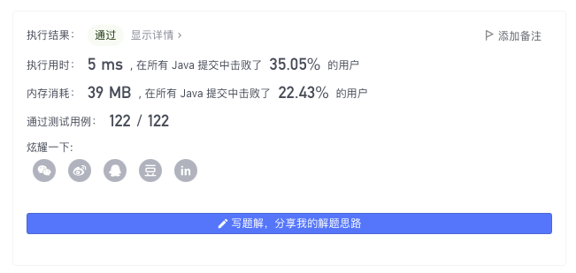
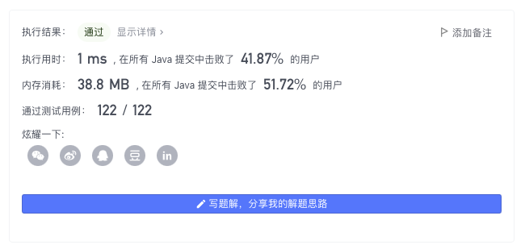
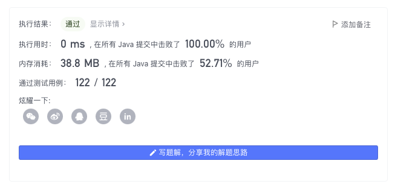

> 原文链接: https://leetcode-cn.com/problems/missing-number


## 英文原文
<div><p>Given an array <code>nums</code> containing <code>n</code> distinct numbers in the range <code>[0, n]</code>, return <em>the only number in the range that is missing from the array.</em></p>

<p>&nbsp;</p>
<p><strong>Example 1:</strong></p>

<pre>
<strong>Input:</strong> nums = [3,0,1]
<strong>Output:</strong> 2
<b>Explanation</b><strong>:</strong> n = 3 since there are 3 numbers, so all numbers are in the range [0,3]. 2 is the missing number in the range since it does not appear in nums.
</pre>

<p><strong>Example 2:</strong></p>

<pre>
<strong>Input:</strong> nums = [0,1]
<strong>Output:</strong> 2
<b>Explanation</b><strong>:</strong> n = 2 since there are 2 numbers, so all numbers are in the range [0,2]. 2 is the missing number in the range since it does not appear in nums.
</pre>

<p><strong>Example 3:</strong></p>

<pre>
<strong>Input:</strong> nums = [9,6,4,2,3,5,7,0,1]
<strong>Output:</strong> 8
<b>Explanation</b><strong>:</strong> n = 9 since there are 9 numbers, so all numbers are in the range [0,9]. 8 is the missing number in the range since it does not appear in nums.
</pre>

<p><strong>Example 4:</strong></p>

<pre>
<strong>Input:</strong> nums = [0]
<strong>Output:</strong> 1
<b>Explanation</b><strong>:</strong> n = 1 since there is 1 number, so all numbers are in the range [0,1]. 1 is the missing number in the range since it does not appear in nums.
</pre>

<p>&nbsp;</p>
<p><strong>Constraints:</strong></p>

<ul>
	<li><code>n == nums.length</code></li>
	<li><code>1 &lt;= n &lt;= 10<sup>4</sup></code></li>
	<li><code>0 &lt;= nums[i] &lt;= n</code></li>
	<li>All the numbers of <code>nums</code> are <strong>unique</strong>.</li>
</ul>

<p>&nbsp;</p>
<p><strong>Follow up:</strong> Could you implement a solution using only <code>O(1)</code> extra space complexity and <code>O(n)</code> runtime complexity?</p>
</div>

## 中文题目
<div><p>给定一个包含 <code>[0, n]</code>&nbsp;中&nbsp;<code>n</code>&nbsp;个数的数组 <code>nums</code> ，找出 <code>[0, n]</code> 这个范围内没有出现在数组中的那个数。</p>

<ul>
</ul>

<p>&nbsp;</p>

<p><strong>示例 1：</strong></p>

<pre>
<strong>输入：</strong>nums = [3,0,1]
<strong>输出：</strong>2
<b>解释：</b>n = 3，因为有 3 个数字，所以所有的数字都在范围 [0,3] 内。2 是丢失的数字，因为它没有出现在 nums 中。</pre>

<p><strong>示例 2：</strong></p>

<pre>
<strong>输入：</strong>nums = [0,1]
<strong>输出：</strong>2
<b>解释：</b>n = 2，因为有 2 个数字，所以所有的数字都在范围 [0,2] 内。2 是丢失的数字，因为它没有出现在 nums 中。</pre>

<p><strong>示例 3：</strong></p>

<pre>
<strong>输入：</strong>nums = [9,6,4,2,3,5,7,0,1]
<strong>输出：</strong>8
<b>解释：</b>n = 9，因为有 9 个数字，所以所有的数字都在范围 [0,9] 内。8 是丢失的数字，因为它没有出现在 nums 中。</pre>

<p><strong>示例 4：</strong></p>

<pre>
<strong>输入：</strong>nums = [0]
<strong>输出：</strong>1
<b>解释：</b>n = 1，因为有 1 个数字，所以所有的数字都在范围 [0,1] 内。1 是丢失的数字，因为它没有出现在 nums 中。</pre>

<p>&nbsp;</p>

<p><strong>提示：</strong></p>

<ul>
	<li><code>n == nums.length</code></li>
	<li><code>1 &lt;= n &lt;= 10<sup>4</sup></code></li>
	<li><code>0 &lt;= nums[i] &lt;= n</code></li>
	<li><code>nums</code> 中的所有数字都 <strong>独一无二</strong></li>
</ul>

<p>&nbsp;</p>

<p><strong>进阶：</strong>你能否实现线性时间复杂度、仅使用额外常数空间的算法解决此问题?</p>
</div>

## 通过代码
<RecoDemo>
</RecoDemo>


## 高赞题解
## 系统排序

一个简单的做法是直接对 $nums$ 进行排序，找到符合 $nums[i] \neq i$ 的位置即是答案，如果不存在 $nums[i] \neq i$ 的位置，则 $n$ 为答案。



代码；
```Java []
class Solution {
    public int missingNumber(int[] nums) {
        int n = nums.length;
        Arrays.sort(nums);
        for (int i = 0; i < n; i++) {
            if (nums[i] != i) return i;
        }
        return n;
    }
}
```
* 时间复杂度：假定 `Arrays.sort` 使用的是双轴快排实现。复杂度为 $O(n\log{n})$
* 空间复杂度：$O(\log{n})$


---

## 数组哈希 

利用 $nums$ 的数值范围为 $[0,n]$，且只有一个值缺失，我们可以直接开一个大小为 $n + 1$ 的数组充当哈希表，进行计数，没被统计到的数值即是答案。


代码：
```Java []
class Solution {
    public int missingNumber(int[] nums) {
        int n = nums.length;
        boolean[] hash = new boolean[n + 1];
        for (int i = 0; i < n; i++) hash[nums[i]] = true;
        for (int i = 0; i < n; i++) {
            if (!hash[i]) return i;
        }
        return n;
    }
}
```
* 时间复杂度：$O(n)$
* 空间复杂度：$O(n)$

---

## 原地哈希

事实上，我们可以将 $nums$ 本身作为哈希表进行使用，将 $nums[i]$ 放到其应该出现的位置（下标） $nums[i]$ 上（ $nums[i] < n$ ），然后对 $nums$ 进行检查，找到满足 $nums[i] \neq i$ 的位置即是答案，如果不存在 $nums[i] \neq i$ 的位置，则 $n$ 为答案。



代码：
```Java []
class Solution {
    public int missingNumber(int[] nums) {
        int n = nums.length;
        for (int i = 0; i < n; i++) {
            if (nums[i] != i && nums[i] < n) swap(nums, nums[i], i--);
        }
        for (int i = 0; i < n; i++) {
            if (nums[i] != i) return i;
        }
        return n;
    }
    void swap(int[] nums, int i, int j) {
        int c = nums[i];
        nums[i] = nums[j];
        nums[j] = c;
    }
}
```
* 时间复杂度：每个元素会被一次性移动到对应位置，因此每个元素的访问次数为常数次。复杂度为 $O(n)$
* 空间复杂度：$O(1)$

---

## 作差法

利用 $nums$ 的数值范围为 $[1, n]$，我们可以先计算出 $[1, n]$ 的总和 $sum$（利用等差数列求和公式），再计算 $nums$ 的总和 $cur$，两者之间的差值即是 $nums$ 中缺失的数字。



代码：
```Java []
class Solution {
    public int missingNumber(int[] nums) {
        int n = nums.length;
        int cur = 0, sum = n * (n + 1) / 2;
        for (int i : nums) cur += i;
        return sum - cur;
    }
}
```
* 时间复杂度：$O(n)$
* 空间复杂度：$O(1)$

---

## 异或

找缺失数、找出现一次数都是异或的经典应用。

我们可以先求得 $[1, n]$ 的异或和 $ans$，然后用 $ans$ 对各个 $nums[i]$ 进行异或。

这样最终得到的异或和表达式中，只有缺失元素出现次数为 $1$ 次，其余元素均出现两次（$x ⊕x = 0$），即最终答案 $ans$ 为缺失元素。


代码：
```Java []
class Solution {
    public int missingNumber(int[] nums) {
        int n = nums.length;
        int ans = 0;
        for (int i = 0; i <= n; i++) ans ^= i;
        for (int i : nums) ans ^= i;
        return ans;
    }
}
```
* 时间复杂度：$O(n)$
* 空间复杂度：$O(1)$

---

## 最后

**题太简单？不如来学习热乎的 $Trie$ 四部曲的最终章 [「可删除/可计数/持久化」Trie](https://mp.weixin.qq.com/s?__biz=MzU4NDE3MTEyMA==&mid=2247489259&idx=1&sn=042ee479cebfbcf1f3b517461b32ddac&chksm=fd9cbdf4caeb34e2254783b211bac795eb0c9bd9b4be844cf48450ca5afa7ca5694fd98f7d39&token=1848397639&lang=zh_CN#rd) ，相关阅读：**

* [$Trie$ 第一部](https://mp.weixin.qq.com/s?__biz=MzU4NDE3MTEyMA==&mid=2247488490&idx=1&sn=db2998cb0e5f08684ee1b6009b974089&chksm=fd9cb8f5caeb31e3f7f67dba981d8d01a24e26c93ead5491edb521c988adc0798d8acb6f9e9d&scene=178&cur_album_id=2049538161285955584#rd)
* [$Trie$ 第二部](https://mp.weixin.qq.com/s?__biz=MzU4NDE3MTEyMA==&mid=2247489083&idx=1&sn=1971fdceb180ef3c7d51f8fbb81527d0&chksm=fd9cbd24caeb34321076e3f34bae0c001c9032b2b1814d15badab26cd4e8cddf48ac051550f6&scene=178&cur_album_id=2049538161285955584#rd)
* [$Trie$ 第三部](https://mp.weixin.qq.com/s?__biz=MzU4NDE3MTEyMA==&mid=2247489106&idx=1&sn=b7c1d4864f42e8a54f4b4754ff9ba8d7&chksm=fd9cbd4dcaeb345b5e39e799bdbeb2e89ed424c763e2af2a23fcb8eab228acc46d10f0395686&token=1901895674&lang=zh_CN#rd)
* [$Trie$ 第四部](https://mp.weixin.qq.com/s?__biz=MzU4NDE3MTEyMA==&mid=2247489259&idx=1&sn=042ee479cebfbcf1f3b517461b32ddac&chksm=fd9cbdf4caeb34e2254783b211bac795eb0c9bd9b4be844cf48450ca5afa7ca5694fd98f7d39&token=1848397639&lang=zh_CN#rd) 

或是加练如下「位运算」内容 🍭🍭🍭

| 题目                                                         | 题解                                                         | 难度 | 推荐指数 |
| ------------------------------------------------------------ | ------------------------------------------------------------ | ---- | -------- |
| [137. 只出现一次的数字 II](https://leetcode-cn.com/problems/single-number-ii/) | [LeetCode 题解链接](https://leetcode-cn.com/problems/single-number-ii/solution/gong-shui-san-xie-yi-ti-san-jie-ha-xi-bi-fku8/) | 中等 | 🤩🤩🤩      |
| [190. 颠倒二进制位](https://leetcode-cn.com/problems/reverse-bits/) | [LeetCode 题解链接](https://leetcode-cn.com/problems/reverse-bits/solution/yi-ti-san-jie-dui-cheng-wei-zhu-wei-fen-ub1hi/) | 简单 | 🤩🤩🤩      |
| [191. 位1的个数](https://leetcode-cn.com/problems/number-of-1-bits/) | [LeetCode 题解链接](https://leetcode-cn.com/problems/number-of-1-bits/solution/yi-ti-san-jie-wei-shu-jian-cha-you-yi-to-av1r/) | 简单 | 🤩🤩🤩      |
| [231. 2 的幂](https://leetcode-cn.com/problems/power-of-two/) | [LeetCode 题解链接](https://leetcode-cn.com/problems/power-of-two/solution/gong-shui-san-xie-2-de-mi-by-ac_oier-qm6e/) | 简单 | 🤩🤩🤩      |
| [260. 只出现一次的数字 III](https://leetcode-cn.com/problems/single-number-iii/) | [LeetCode 题解链接](https://leetcode-cn.com/problems/single-number-iii/solution/gong-shui-san-xie-yi-ti-shuang-jie-ha-xi-zgi4/) | 中等 | 🤩🤩🤩🤩     |
| [268. 丢失的数字](https://leetcode-cn.com/problems/missing-number/) | [LeetCode 题解链接](https://leetcode-cn.com/problems/missing-number/solution/gong-shui-san-xie-yi-ti-wu-jie-pai-xu-ji-te3s/) | 简单 | 🤩🤩🤩🤩     |
| [338. 比特位计数](https://leetcode-cn.com/problems/counting-bits/) | [LeetCode 题解链接](https://leetcode-cn.com/problems/counting-bits/solution/po-su-jie-fa-dong-tai-gui-hua-jie-fa-by-vvail/) | 简单 | 🤩🤩🤩      |
| [342. 4的幂](https://leetcode-cn.com/problems/power-of-four/) | [LeetCode 题解链接](https://leetcode-cn.com/problems/power-of-four/solution/gong-shui-san-xie-zhuan-hua-wei-2-de-mi-y21lq/) | 简单 | 🤩🤩🤩      |
| [371. 两整数之和](https://leetcode-cn.com/problems/sum-of-two-integers/) | [LeetCode 题解链接](https://leetcode-cn.com/problems/sum-of-two-integers/solution/gong-shui-san-xie-shi-yong-wei-yun-suan-4hpb7/) | 中等 | 🤩🤩🤩🤩     |
| [405. 数字转换为十六进制数](https://leetcode-cn.com/problems/convert-a-number-to-hexadecimal/) | [LeetCode 题解链接](https://leetcode-cn.com/problems/convert-a-number-to-hexadecimal/solution/gong-shui-san-xie-yi-ti-shuang-jie-jin-z-d93o/) | 简单 | 🤩🤩🤩🤩     |
| [461. 汉明距离](https://leetcode-cn.com/problems/hamming-distance/) | [LeetCode 题解链接](https://leetcode-cn.com/problems/hamming-distance/solution/gong-shui-san-xie-tong-ji-liang-shu-er-j-987a/) | 简单 | 🤩🤩🤩🤩     |
| [476. 数字的补数](https://leetcode-cn.com/problems/number-complement/) | [LeetCode 题解链接](https://leetcode-cn.com/problems/number-complement/solution/gong-shui-san-xie-yi-ti-shuang-jie-bian-wjl0y/) | 简单 | 🤩🤩🤩🤩     |
| [477. 汉明距离总和](https://leetcode-cn.com/problems/total-hamming-distance/) | [LeetCode 题解链接](https://leetcode-cn.com/problems/total-hamming-distance/solution/gong-shui-san-xie-ying-yong-cheng-fa-yua-g21t/) | 简单 | 🤩🤩🤩🤩     |
| [526. 优美的排列](https://leetcode-cn.com/problems/beautiful-arrangement/) | [LeetCode 题解链接](https://leetcode-cn.com/problems/beautiful-arrangement/solution/gong-shui-san-xie-xiang-jie-liang-chong-vgsia/) | 中等 | 🤩🤩🤩      |
| [1178. 猜字谜](https://leetcode-cn.com/problems/number-of-valid-words-for-each-puzzle/) | [LeetCode 题解链接](https://leetcode-cn.com/problems/number-of-valid-words-for-each-puzzle/solution/xiang-jin-zhu-shi-xiang-jie-po-su-wei-yu-3cr2/) | 困难 | 🤩🤩🤩🤩     |
| [1711. 大餐计数](https://leetcode-cn.com/problems/count-good-meals/) | [LeetCode 题解链接](https://leetcode-cn.com/problems/count-good-meals/solution/gong-shui-san-xie-xiang-jie-san-chong-gu-nn4f/) | 中等 | 🤩🤩🤩      |
| [剑指 Offer 15. 二进制中1的个数](https://leetcode-cn.com/problems/er-jin-zhi-zhong-1de-ge-shu-lcof/) | [LeetCode 题解链接](https://leetcode-cn.com/problems/er-jin-zhi-zhong-1de-ge-shu-lcof/solution/gong-shui-san-xie-yi-ti-si-jie-wei-shu-j-g9w6/) | 简单 | 🤩🤩🤩      |

**注：以上目录整理来自 [wiki](https://github.com/SharingSource/LogicStack-LeetCode/wiki/位运算)，任何形式的转载引用请保留出处。**

---

## 最后

**如果有帮助到你，请给题解点个赞和收藏，让更多的人看到 ~ ("▔□▔)/**

也欢迎你 [关注我](https://oscimg.oschina.net/oscnet/up-19688dc1af05cf8bdea43b2a863038ab9e5.png)（公主号后台回复「送书」即可参与长期看题解学算法送实体书活动）或 加入[「组队打卡」](https://leetcode-cn.com/u/ac_oier/)小群 ，提供写「证明」&「思路」的高质量题解。

所有题解已经加入 [刷题指南](https://github.com/SharingSource/LogicStack-LeetCode/wiki)，欢迎 star 哦 ~ 

## 统计信息
| 通过次数 | 提交次数 | AC比率 |
| :------: | :------: | :------: |
|    195247    |    299992    |   65.1%   |

## 提交历史
| 提交时间 | 提交结果 | 执行时间 |  内存消耗  | 语言 |
| :------: | :------: | :------: | :--------: | :--------: |


## 相似题目
|                             题目                             | 难度 |
| :----------------------------------------------------------: | :---------: |
| [缺失的第一个正数](https://leetcode-cn.com/problems/first-missing-positive/) | 困难|
| [只出现一次的数字](https://leetcode-cn.com/problems/single-number/) | 简单|
| [寻找重复数](https://leetcode-cn.com/problems/find-the-duplicate-number/) | 中等|
| [情侣牵手](https://leetcode-cn.com/problems/couples-holding-hands/) | 困难|
