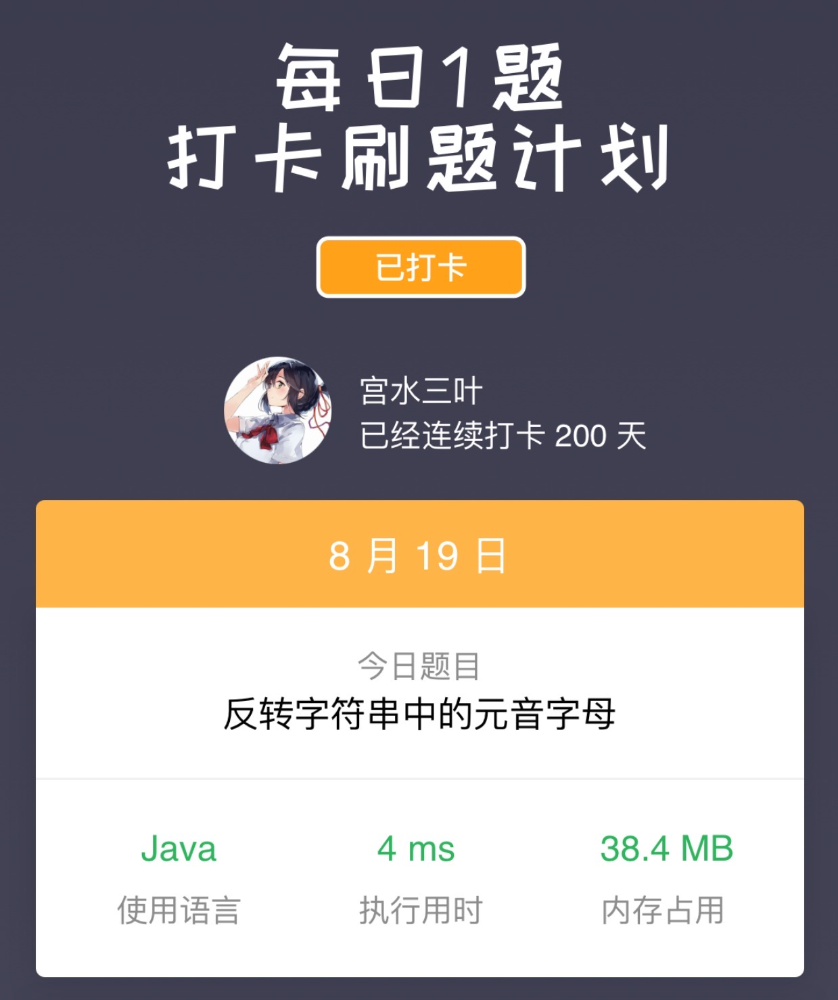

> 原文链接: https://leetcode-cn.com/problems/reverse-vowels-of-a-string


## 英文原文
<div><p>Given a string <code>s</code>, reverse only all the vowels in the string and return it.</p>

<p>The vowels are <code>&#39;a&#39;</code>, <code>&#39;e&#39;</code>, <code>&#39;i&#39;</code>, <code>&#39;o&#39;</code>, and <code>&#39;u&#39;</code>, and they can appear in both cases.</p>

<p>&nbsp;</p>
<p><strong>Example 1:</strong></p>
<pre><strong>Input:</strong> s = "hello"
<strong>Output:</strong> "holle"
</pre><p><strong>Example 2:</strong></p>
<pre><strong>Input:</strong> s = "leetcode"
<strong>Output:</strong> "leotcede"
</pre>
<p>&nbsp;</p>
<p><strong>Constraints:</strong></p>

<ul>
	<li><code>1 &lt;= s.length &lt;= 3 * 10<sup>5</sup></code></li>
	<li><code>s</code> consist of <strong>printable ASCII</strong> characters.</li>
</ul>
</div>

## 中文题目
<div><p>给你一个字符串 <code>s</code> ，仅反转字符串中的所有元音字母，并返回结果字符串。</p>

<p>元音字母包括 <code>'a'</code>、<code>'e'</code>、<code>'i'</code>、<code>'o'</code>、<code>'u'</code>，且可能以大小写两种形式出现。</p>

<p>&nbsp;</p>

<p><strong>示例 1：</strong></p>

<pre>
<strong>输入：</strong>s = "hello"
<strong>输出：</strong>"holle"
</pre>

<p><strong>示例 2：</strong></p>

<pre>
<strong>输入：</strong>s = "leetcode"
<strong>输出：</strong>"leotcede"</pre>

<p>&nbsp;</p>

<p><strong>提示：</strong></p>

<ul>
	<li><code>1 &lt;= s.length &lt;= 3 * 10<sup>5</sup></code></li>
	<li><code>s</code> 由 <strong>可打印的 ASCII</strong> 字符组成</li>
</ul>
</div>

## 通过代码
<RecoDemo>
</RecoDemo>


## 高赞题解
## 双指针

一个朴素的做法是利用「双指针」进行前后扫描，当左右指针都是元音字母时，进行互换并移到下一位。

由于元音字母相对固定，因此我们可以使用容器将其存储，并使用 `static` 修饰，确保整个容器的创建和元音字母的填入在所有测试样例中只会发生一次。

我们期望该容器能在 $O(1)$ 的复杂度内判断是否为元音字母，可以使用语言自带的哈希类容器（$P2$ 代码）或是使用数组模拟（$P1$ 代码）。

> 一些细节：由于题目没有说字符串中只包含字母，因此在使用数组模拟哈希表时，我们需要用当前字符减去 ASCII 码的最小值（空字符），而不是 'A'

代码：
```Java []
class Solution {
    static boolean[] hash = new boolean[128];
    static char[] vowels = new char[]{'a','e','i','o','u'};
    static {
        for (char c : vowels) {
            hash[c - ' '] = hash[Character.toUpperCase(c) - ' '] = true;
        }
    }
    public String reverseVowels(String s) {
        char[] cs = s.toCharArray();
        int n = s.length();
        int l = 0, r = n - 1;
        while (l < r) {
            if (hash[cs[l] - ' '] && hash[cs[r] - ' ']) {
                swap(cs, l++, r--);
            } else {
                if (!hash[cs[l] - ' ']) l++;
                if (!hash[cs[r] - ' ']) r--;
            }
        }
        return String.valueOf(cs);
    }
    void swap(char[] cs, int l, int r) {
        char c = cs[l];
        cs[l] = cs[r];
        cs[r] = c;
    }
}
```
```Java []
class Solution {
    static char[] vowels = new char[]{'a','e','i','o','u'};
    static Set<Character> set = new HashSet<>();
    static {
        for (char c : vowels) {
            set.add(c);
            set.add(Character.toUpperCase(c));
        }
    }
    public String reverseVowels(String s) {
        char[] cs = s.toCharArray();
        int n = s.length();
        int l = 0, r = n - 1;
        while (l < r) {
            if (set.contains(cs[l]) && set.contains(cs[r])) {
                swap(cs, l++, r--);
            } else {
                if (!set.contains(cs[l])) l++;
                if (!set.contains(cs[r])) r--;
            }
        }
        return String.valueOf(cs);
    }
    void swap(char[] cs, int l, int r) {
        char c = cs[l];
        cs[l] = cs[r];
        cs[r] = c;
    }
}
```
* 时间复杂度：$O(n)$
* 空间复杂度：由于 `toCharArray` 会创建新数组，复杂度为 $O(n)$

---

## 特别的日子

今天是连续打卡的第 $200$ 天，也就是连续发布「每日一题」题解 $200$ 天 ~ 🤣

短短 $200$ 天认识了很多很有意思的小伙伴，开心的事情也比不开心的事情的要多得多，十分感谢 🙏

开个赞赏图一乐，还是那个赞赏原则：**学生免费，非学生是否赞赏都能看。**

同时力扣「赞赏」行为的发生，必须基于「你十分喜欢该作者」&「你十分喜欢该平台」，两者缺一不可。

如果你确定满足上述所有条件的话，可以花费 **最多一元** 领个头像牌子 🤣，否则只需给我点个赞留个言，我也同样开心 ❤️ 




## 统计信息
| 通过次数 | 提交次数 | AC比率 |
| :------: | :------: | :------: |
|    112802    |    209016    |   54.0%   |

## 提交历史
| 提交时间 | 提交结果 | 执行时间 |  内存消耗  | 语言 |
| :------: | :------: | :------: | :--------: | :--------: |


## 相似题目
|                             题目                             | 难度 |
| :----------------------------------------------------------: | :---------: |
| [反转字符串](https://leetcode-cn.com/problems/reverse-string/) | 简单|
| [删去字符串中的元音](https://leetcode-cn.com/problems/remove-vowels-from-a-string/) | 简单|
