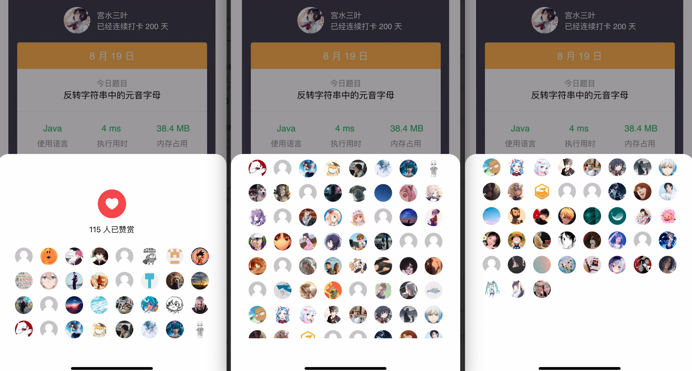

> 原文链接: https://leetcode-cn.com/problems/reverse-string-ii


## 英文原文
<div><p>Given a string <code>s</code> and an integer <code>k</code>, reverse the first <code>k</code> characters for every <code>2k</code> characters counting from the start of the string.</p>

<p>If there are fewer than <code>k</code> characters left, reverse all of them. If there are less than <code>2k</code> but greater than or equal to <code>k</code> characters, then reverse the first <code>k</code> characters and left the other as original.</p>

<p>&nbsp;</p>
<p><strong>Example 1:</strong></p>
<pre><strong>Input:</strong> s = "abcdefg", k = 2
<strong>Output:</strong> "bacdfeg"
</pre><p><strong>Example 2:</strong></p>
<pre><strong>Input:</strong> s = "abcd", k = 2
<strong>Output:</strong> "bacd"
</pre>
<p>&nbsp;</p>
<p><strong>Constraints:</strong></p>

<ul>
	<li><code>1 &lt;= s.length &lt;= 10<sup>4</sup></code></li>
	<li><code>s</code> consists of only lowercase English letters.</li>
	<li><code>1 &lt;= k &lt;= 10<sup>4</sup></code></li>
</ul>
</div>

## 中文题目
<div><p>给定一个字符串 <code>s</code> 和一个整数 <code>k</code>，从字符串开头算起，每计数至 <code>2k</code> 个字符，就反转这 <code>2k</code> 字符中的前 <code>k</code> 个字符。</p>

<ul>
	<li>如果剩余字符少于 <code>k</code> 个，则将剩余字符全部反转。</li>
	<li>如果剩余字符小于 <code>2k</code> 但大于或等于 <code>k</code> 个，则反转前 <code>k</code> 个字符，其余字符保持原样。</li>
</ul>

<p>&nbsp;</p>

<p><strong>示例 1：</strong></p>

<pre>
<strong>输入：</strong>s = "abcdefg", k = 2
<strong>输出：</strong>"bacdfeg"
</pre>

<p><strong>示例 2：</strong></p>

<pre>
<strong>输入：</strong>s = "abcd", k = 2
<strong>输出：</strong>"bacd"
</pre>

<p>&nbsp;</p>

<p><strong>提示：</strong></p>

<ul>
	<li><code>1 &lt;= s.length &lt;= 10<sup>4</sup></code></li>
	<li><code>s</code> 仅由小写英文组成</li>
	<li><code>1 &lt;= k &lt;= 10<sup>4</sup></code></li>
</ul>
</div>

## 通过代码
<RecoDemo>
</RecoDemo>


## 高赞题解
## 模拟

使用 `l` 和 `r` 两个指针分别圈出每次需要翻转的“理论”范围，每次翻转完更新 `l` 和 `r`，同时注意范围 $[l, r]$ 内不足 $k$ 个的情况（将 `r` 与真实边界 `n - 1`取个 $min$）。

代码：
```Java []
class Solution {
    public String reverseStr(String s, int k) {
        char[] cs = s.toCharArray();
        int n = s.length();
        for (int l = 0; l < n; l = l + 2 * k) {
            int r = l + k - 1;
            reverse(cs, l, Math.min(r, n - 1));
        }
        return String.valueOf(cs);
    }
    void reverse(char[] cs, int l, int r) {
        while (l < r) {
            char c = cs[l];
            cs[l] = cs[r];
            cs[r] = c;
            l++; r--;
        }
    }
}
```
* 时间复杂度：$O(n)$
* 空间复杂度：Java 中 `String` 属于不可变，复杂度为 $O(n)$

---

## 特别感谢

**再次感谢昨天有给三叶点 ❤️ 的小伙伴，截止至 2021/08/20 10:00:00 有 $115$ 人，太有排面了，截个全家福纪念一下 🤣 呜呜呜，感谢（其他没有入镜的同学，是在帮忙拿相机拍照啦，也感谢他们 ~**




---

## 最后

**如果有帮助到你，请给题解点个赞和收藏，让更多的人看到 ~ ("▔□▔)/**

也欢迎你 [关注我](https://oscimg.oschina.net/oscnet/up-19688dc1af05cf8bdea43b2a863038ab9e5.png)（公主号后台回复「送书」即可参与长期看题解学算法送实体书活动）或 加入[「组队打卡」](https://leetcode-cn.com/u/ac_oier/)小群 ，提供写「证明」&「思路」的高质量题解。

所有题解已经加入 [刷题指南](https://github.com/SharingSource/LogicStack-LeetCode/wiki)，欢迎 star 哦 ~ 

## 统计信息
| 通过次数 | 提交次数 | AC比率 |
| :------: | :------: | :------: |
|    79392    |    131360    |   60.4%   |

## 提交历史
| 提交时间 | 提交结果 | 执行时间 |  内存消耗  | 语言 |
| :------: | :------: | :------: | :--------: | :--------: |


## 相似题目
|                             题目                             | 难度 |
| :----------------------------------------------------------: | :---------: |
| [反转字符串](https://leetcode-cn.com/problems/reverse-string/) | 简单|
| [反转字符串中的单词 III](https://leetcode-cn.com/problems/reverse-words-in-a-string-iii/) | 简单|
